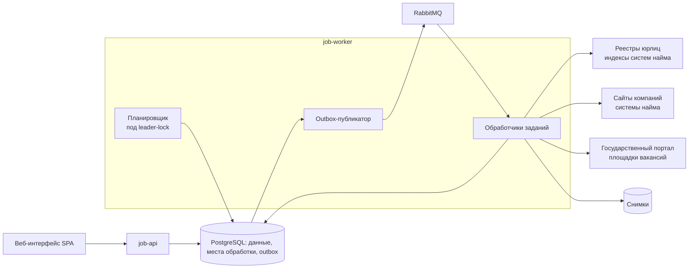
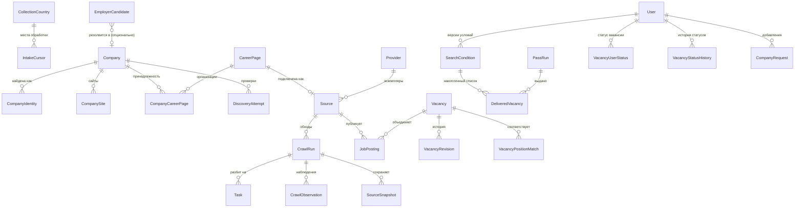
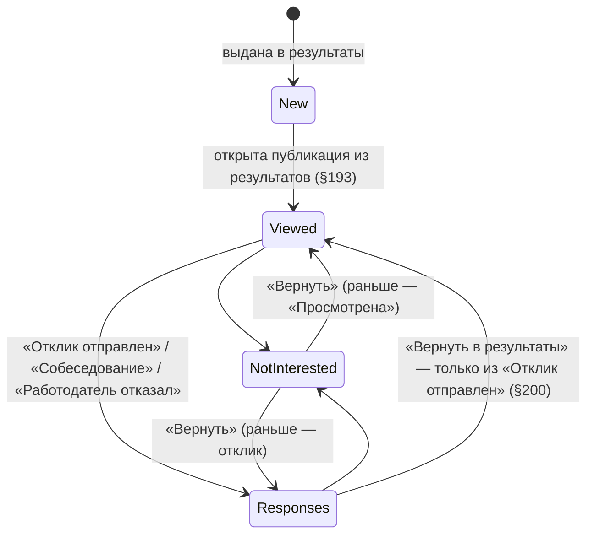

# Технический документ: Roleorienta

## Оглавление

1. Введение (назначение, связь с бизнес-описанием, глоссарий)
2. Обзор архитектуры (компоненты, диаграмма, принципы)
3. Технологический стек (выбор с обоснованием)
4. Модель данных (сущности, связи, инварианты)
5. Источники и адаптеры (контракт адаптера, обнаружение, принадлежность, лимиты)
6. Конвейер обработки (единицы работы, шаги, стадии)
7. Выдача пользователю (отбор, проходы, место остановки)
8. REST API (контракты и принципы)
9. Надёжность и качество данных
10. Безопасность и правовые правила
11. Наблюдаемость и показатели ядра
12. Развёртывание (Docker, профили, Kubernetes)
13. CI/CD и GitOps
14. Тестирование, приёмка и эксперименты
15. Этапность разработки
16. Архитектурные решения (выбор с обоснованием)
17. Значения по умолчанию

---

## 1. Введение

**Назначение документа.** Описывает технические решения и этапность разработки. Это рабочий
документ: он фиксирует, *что* строим и *почему именно так*, на уровне, достаточном чтобы начать
кодить; мелкие детали дорабатываются в коде. Документ реализует бизнес-описание приложения; ссылки
«бизнес-описание §N» ведут на его разделы.

**Связь с бизнес-описанием.** Страны, реестры и поддерживаемые форматы кадровых страниц — это
настройка и набор адаптеров, а не архитектурное решение: первая страна — Словакия, следующие
подключаются конфигурацией и новыми адаптерами реестров без изменения ядра. Вопросы, которые бизнес-описание
оставляет на реализацию (бизнес-описание §12), здесь решены; числовые значения — настройки, начальные значения в §17.

**Принцип изложения.** Ключевые решения сопровождаются кратким обоснованием; развёрнутые
обоснования — в §16. Конкретные версии библиотек фиксируются
перед реализацией после проверки совместимости.

**Принципы проектирования.** Проверенные, актуальные инженерные практики: API-first,
транзакционная согласованность и идемпотентность, наблюдаемость, воспроизводимое развёртывание —
без устаревших решений и без усложнения без необходимости. Неизвестное не угадывается. Всё, что
делает общий сбор, выполняется автоматически, без ручного подтверждения (бизнес-описание §4.2).

**Глоссарий.** Термины бизнес-описания (компания, система найма, доска, кадровая страница, общий
сбор, партия, проход, порция, лимит порции, накопленный список, место остановки — бизнес-описание §2)
используются в том же значении. Технические термины:

| Термин | Значение |
|---|---|
| **Провайдер** (`Provider`) | Тип интеграции: конкретная система найма (Workday, Personio, Greenhouse, SmartRecruiters, SAP SuccessFactors …), общий формат schema.org `JobPosting`, собственная страница вакансий сайта компании, государственный портал вакансий, площадка вакансий (profesia.sk); описывается capability-карточкой (§5) |
| **Источник** (`Source`) | Подключённая кадровая страница — доска системы найма, страница сайта с `JobPosting` или собственная страница вакансий — либо вакансии работодателя на государственном портале или площадке: адрес, провайдер, расписание, лимиты, состояние |
| **Канал вакансий** | Где работодатель публикует вакансии: своя кадровая страница (сайт, система найма), государственный портал вакансий страны, площадка вакансий. Замер этапа 0 (§15): у массовых работодателей вакансии обычно только в одном канале. В этапе 1 используются своя кадровая страница и государственный портал (вместе с объявлениями площадок); площадка напрямую — после этапа 1. У каждой компании читается один, лучший канал (§5.1; исключение — доска кадрового сайта группы, §5.1) |
| **Государственный портал вакансий** | Портал службы занятости страны, куда работодатели обязаны сообщать вакансии; Словакия — Služby zamestnanosti (`sluzbyzamestnanosti.gov.sk`). Даёт работодателя с регистрационным номером, его вакансии и указанный им сайт |
| **Площадка вакансий** | Частный сайт объявлений о работе (Словакия — profesia.sk); используется только при записанном основании (§10). В первом этапе вакансии с площадок напрямую не читаются; profesia.sk — путь к сайту и кадровой странице компании (§5.1) |
| **Публикация** (`JobPosting`) | Запись вакансии в одном конкретном источнике |
| **Вакансия** (`Vacancy`) | Одна вакансия работодателя; объединяет одну или несколько публикаций (бизнес-описание §4.3) |
| **Обход** (`CrawlRun`) | Одно чтение списка публикаций источника; имеет область и признак полноты |
| **Находка** (`EmployerCandidate`) | Результат входа обнаружения (запись реестра, доска из индекса, запрос пользователя) до установления связи с компанией |
| **Гейт принадлежности** | Проверка, без прохождения которой кадровая страница не подключается (§5); неподтверждённое не подключается и перепроверяется позже |
| **Outbox** | Таблица исходящих событий: сообщение публикуется в брокер только если зафиксирована транзакция, его породившая |
| **Идемпотентность** | Повторная обработка того же события не создаёт дублей и побочных эффектов |
| **Leader-lock** | Блокировка в PostgreSQL, гарантирующая, что периодический тик выполняет одна реплика |

## 2. Обзор архитектуры

**Форма системы.** Один репозиторий, два развёртываемых приложения на Spring Boot (§16.1):

| Компонент | Ответственность |
|---|---|
| `job-api` | Учётные записи и вход; условия поиска; накопленный список и сведения о вакансии; статусы вакансии у пользователя и их история; запросы на добавление компании; показатели ядра для владельца; административные операции. Владеет схемой БД (миграции) |
| `job-worker` | Планирование под leader-lock; публикация outbox; общий сбор: приём компаний и партии стран, обнаружение сайта и кадровых страниц, гейт принадлежности, чтение источников, нормализация, объединение публикаций, состояния вакансий; предрасчёт соответствия; проходы выдачи; расчёт показателей |
| **PostgreSQL** | Данные продукта, история, задания, контрольные точки, места обработки и остановки, outbox |
| **RabbitMQ** | Доставка фоновых заданий (§16.2) |
| **Объектное хранилище** (S3-совместимое) | Снимки исходных ответов источников для повторной обработки (§16.10) |
| **Веб-интерфейс (SPA)** | Минимальный пользовательский интерфейс по бизнес-описанию §7.2 и экран показателей; отдельный фронтенд-артефакт, потребляющий REST API (§16.17) |

**Модули.** Обнаружение (компании, сайты, кадровые страницы), сбор (источники, обходы,
публикации), каталог вакансий (объединение, состояния, история), отбор, выдача, учётные записи,
показатели. Общая БД; отдельный сервис на этап обработки не требуется. Каждый тип системы найма —
один адаптер за общим контрактом.



**Общий сбор и выдача развязаны (бизнес-описание §4).** Обнаружение и чтение источников идут непрерывно по
своим расписаниям; проход выдачи только читает уже собранные и отобранные данные. Общий сбор не
получает условий пользователей — только перечень стран сбора (бизнес-описание §4.1, §10).

**Единственность планировщика и публикатора при масштабировании (§16.4).** Планировщик и
outbox-публикатор — логические роли внутри `job-worker`: (1) тики — под **leader-lock в
PostgreSQL** с ограниченной арендой; (2) планирование **идемпотентно** — уникальный ключ на
окно расписания (`(источник, окно)`, `(участник, курсор)` партии, `(проход, время)`); (3) публикатор
захватывает события outbox через `SELECT … FOR UPDATE SKIP LOCKED`. `minReplicaCount: 1`
сохраняет роль планирования при простое очереди. Обработка заданий идёт параллельно на всех
репликах.

**Доставка заданий с первого этапа (§16.2).** Планировщик под leader-lock ставит задание и
outbox-событие в одной транзакции; публикатор отправляет его в брокер с publisher confirms и
проверкой маршрутизации; обработчики потребляют идемпотентно. KEDA-масштабирование по длине
очереди — этап 3, не меняет модель данных и контракты.

**Три очереди заданий (стенограмма §46, §51).** Очередь **сбора** — чтение источников, предрасчёт
соответствий, проходы выдачи; очередь **поиска** — приём реестра, скан сайтов, проверка кадровых
страниц, обратный путь, государственный портал, справочник GeoNames; очередь **адреса по названию** — шаги
3–4 поиска сайта (до 36 адресов на компанию, цепочка на дни). Очередь выбирается по типу
задания при публикации outbox; у каждой очереди своё число обработчиков (§17). Многочасовые цепочки
поиска не занимают обработчики сбора, поэтому вакансии читаются вовремя. Цепочка шага (число сотрудников,
адрес по названию, Wikidata, проверка кадровых страниц) начинается заново, только когда прежняя закончилась
(незавершённое задание её типа, менявшееся за сутки, держит цепочку; стенограмма §70). На этапе 3 тот же `job-worker`
можно запускать отдельными экземплярами для каждой очереди настройкой, без изменения кода.

**Подход к интерфейсу (§16.17).** SPA (React, TypeScript, Vite) потребляет REST API
`job-api`; отдаётся как статический артефакт; интерфейс минимальный, чистый и адаптивный под
мобильный экран. OpenAPI UI — только для разработки и демонстрации.

## 3. Технологический стек

Колонка «Этап» — когда элемент нужен (§15); major-версии не обновляются автоматически.

| Область | Выбор | Обоснование / граница | Этап |
|---|---|---|---|
| Язык | Java 21 LTS | Долгая поддержка; целевая экосистема backend | 1 |
| Каркас | Spring Boot 4.1 | Web, DI, безопасность, данные | 1 |
| API и безопасность | Spring Web, Validation, Spring Security, OpenAPI | REST, валидация, роли и владелец, машинный контракт | 1 |
| Данные | PostgreSQL, Spring Data JPA, Flyway | Транзакции, массивы, частичные индексы, блокировки, версионируемые миграции | 1 |
| Очередь | RabbitMQ, Spring AMQP | At-least-once, подтверждения, DLQ; KEDA — этап 3 | 1 |
| Сбор | Apache HttpClient 5 за выделенным клиентом (§10: подменённое определение адреса проверяет каждое соединение); Jackson — JSON; StAX с защитой XXE — XML; Jsoup — разбор HTML (ссылки, реквизиты, JSON-LD, списки вакансий) | Структурированные ленты и разметка там, где они есть; HTML — для обнаружения, собственных страниц вакансий, государственного портала, площадок и систем найма без ленты (SuccessFactors, SmartRecruiters, Phenom, страницы вакансий Taleo) | 1 |
| Снимки | S3-совместимое хранилище (локально SeaweedFS) | Повторная обработка без нового внешнего наблюдения | 1 |
| Фронтенд | SPA (React), TypeScript, Vite | Отдельный артефакт, потребляет REST | 1 |
| Справочники | GeoNames (город → страна, CC BY 4.0); словарь регионов удалённой работы; словарь позиций — данные с версией в БД (`position`, `position_term`, `position_dictionary`; правит администратор, срез 6б; стенограмма §159) | Детерминированный отбор без ручных списков в коде | 1 |
| Тесты | JUnit, Testcontainers, заглушки источников на встроенном HTTP-сервере JDK, ArchUnit | Интеграция на реальных PG/брокере; тестовые источники | 1 |
| Правила кода | Checkstyle, ArchUnit | Нарушение ломает сборку | 1 |
| Образы | Spring Boot `bootBuildImage` + Docker Compose | Один способ сборки | 1 |
| CI | GitHub Actions (компиляция, тесты, приёмка) | С первого дня | 1 |
| Проверка образов | Trivy + SBOM | Уязвимости и состав зависимостей | 4 |
| Kubernetes | Helm, KEDA, Gateway API + Envoy Gateway | Развёртывание, масштабирование по очереди | 3 |
| TLS и секреты | cert-manager + Sealed Secrets | Демо-кластер | 3 |
| Метрики и трассировка | Actuator, Micrometer, Prometheus, Grafana, OpenTelemetry, Tempo | Сквозные трассы и дашборды | 3 |
| GitOps | kind (smoke), Argo CD (демо) | Синхронизация демо-окружения | 4 |

**Границы стека.** PostgreSQL, RabbitMQ, объектное хранилище и два приложения достаточны. Kafka,
service mesh, поисковый кластер, Redis и LLM **не добавляются без отдельного требования**.

## 4. Модель данных

**Сущности.**

| Сущность | Назначение |
|---|---|
| `User` | Учётная запись: вход, роль (`USER`/`ADMIN`); язык интерфейса `language` (§162); сводка на почту (§164): частота `digest_frequency`, часовой пояс `time_zone` (IANA, браузера; сверяется при открытии приложения — §165), день отработанной сводки `digest_day` |
| `PositionSearchMiss` | Запрос подсказки позиции без результата: строка (в нижнем регистре), сколько раз, когда последний раз — для администратора (§205; заменил предложения позиций §161) |
| `DigestVacancy` | Вакансия, уже попавшая в сводку на почту пользователя: пользователь + вакансия, время письма; вакансия приходит в письме один раз (§165, заменила границу `digest_sent_until`) |
| `CollectionCountry` | Страна общего сбора: активна ли (есть пользователь с этой страной), время последней партии, поколение и дата завершения первичного обхода (бизнес-описание §4.1) |
| `IntakeCursor` | Место обработки источника компаний: для реестра — в стране, для индекса систем найма — общее; курсор, граница поколения первичного обхода, время исчерпания |
| `EmployerCandidate` | Находка входа обнаружения: вход (реестр/индекс/запрос пользователя), исходные данные, статус резолва; **связь с `Company` необязательна** — находка существует до её установления |
| `Company` | Организация: страна регистрации, регистрационный номер, название, признак кадрового агентства, категория числа сотрудников (Словакия — RÚZ; нужна правилу «крупная компания», §5.1), поколение первичного обхода и дата первого итога проверки, срок перепроверки; атрибуция реестра (RPO — CC BY 4.0) |
| `CompanyIdentity` | Подтверждённая идентичность организации: регистрационный номер уникален в пространстве страны и реестра; домен и доска — связи с организациями, не глобальные уникальные идентификаторы юрлица. Обнаружение повторно использует установленную идентичность |
| `CompanySite` | Связь организации с сайтом и доказательством принадлежности (регистрационный номер на сайте; сайт или домен почты, указанные работодателем на государственном портале; бренд крупной компании — §5.1); организация может иметь несколько сайтов, сайт — несколько подтверждённых организаций |
| `CareerPage` | Кадровая страница с уникальным адресом (для Workday — тенант + сайт); связанные организации — через `CompanyCareerPage` |
| `CompanyCareerPage` | Проверенная связь организации и кадровой страницы: роль (**работодатель**, **размещающее агентство** или **кадровый сайт группы** — доска на сайте-кандидате, принадлежность не подтверждена, §81), способ и дата подтверждения принадлежности; многие-ко-многим (одна доска может обслуживать несколько юрлиц группы) |
| `DiscoveryAttempt` | Попытка поиска/проверки компании: результат, причина, найденный формат, дата, срок перепроверки; адрес страницы необязателен |
| `CrawlObservation` | Наблюдения публикаций в текущем обходе; применяются к публикациям при завершении обхода (§6) |
| `Provider` | Тип интеграции и его **capability-карточка**: list/detail, пагинация, полнота перечисления, признак закрытия публикации, фасеты стран, семантика дат, условные запросы, требования доступа (§5) |
| `Source` | Подключённая кадровая страница: ссылается на `CareerPage` и `Provider`; расписание, лимиты, версия адаптера, доступность (`OK`/`TEMP_FAILING`/`UNAVAILABLE`), даты попыток и успехов |
| `SourcePermission` | Основание использования источника (бизнес-описание §10): область (провайдер — включая государственный портал и площадки, домен, агентство), решение, основание, дата проверки |
| `CrawlRun` | Обход источника: неизменная область (в т. ч. фильтр страны), конечное состояние (`COMPLETE`/`PARTIAL`/`FAILED`), вид отказа (временный / доступ запрещён / страница удалена), контрольная точка |
| `Task` | Фоновое задание любого типа (§6): тип, ключ идемпотентности, попытки, время следующей попытки, состояние, контрольная точка |
| `SourceSnapshot` | Исходный ответ источника: ключ в хранилище, хеш, время, версия адаптера |
| `JobPosting` | Публикация в источнике: внешний ID, адрес, исходные и нормализованные поля, текст (для отбора, не показывается), даты, счётчик полных обходов без публикации, явное закрытие |
| `Vacancy` | Вакансия: работодатель, агентство, позиция, страны выполнения работы, территория удалёнки, формат (страна не определена — пустой список стран, неясность формата — пометка API, §154), состояние (`ACTIVE`/`NEEDS_RECHECK`/`CLOSED`), даты первого обнаружения и последнего подтверждения, дата размещения работодателем (`posted_at`, самая ранняя из данных источниками, §127), ссылка на первичную публикацию |
| `VacancyRevision` | Изменение значимого поля: было → стало, публикация-источник, ревизия (история с первого обнаружения) |
| `Position` | Словарь позиций (данные с версией, в БД — §159): каноническая позиция; названия по видам — `position_term` (`TITLE` эквивалентные названия, `ROLE` роли, `KEYWORD` признаки специализации, `EXCLUDE` исключающие слова); общие настройки и номер версии — `position_dictionary` (версия сопоставления — `d<номер>`) |
| `VacancyPositionMatch` | Предрасчитанное соответствие вакансии позиции: версия словаря и версия правил, объяснение (какое название и признак сработали) |
| `SearchCondition` | Условия поиска пользователя — **версия**: страны, позиции словаря и группы ISCO-08 (вместе 1–10, `search_condition_position`, `search_condition_occupation`, §126, §204), формат; лимит порции (хранится, выдача его не применяет — §120); одна активная на пользователя (бизнес-описание §3) |
| `PassRun` | Проход по расписанию: время окна (уникально), состояние |
| `DeliveredVacancy` | Вакансия, выданная по версии условий: проход, время; уникальна в паре «версия условий + вакансия» — это накопленный список и место остановки (§7) |
| `VacancyUserStatus` | Текущий статус вакансии у пользователя («Просмотрена», «Не интересно», «Отклик отправлен», «Собеседование», «Работодатель отказал»; строки нет — «Новая»): пользователь + вакансия; не зависит от версии условий (бизнес-описание §6; стенограмма §156; заменил отметку «не подходит» `unsuitable_mark`) |
| `VacancyStatusHistory` | Строки истории статусов пользователя: статус (и «Возвращена»), время, день пользователя по поясу браузера; «Получена» и «Закрыта работодателем» не хранятся — их собирает API из `delivered_vacancy` и `vacancy.closed_at` (§156) |
| `VacancyLanguage` | Требование к языку у вакансии: язык (ISO 639-1), обязателен или желателен; предрасчёт job-worker из текста публикаций; строк нет — «не указано» (бизнес-описание §6; стенограмма §158) |
| `CompanyRequest` | Запрос пользователя на добавление компании: ввод, найденная компания, состояние и причина (бизнес-описание §5) |
| `FailedOperation` | Операция, не выполненная после всех попыток: тип, объект, причина, время — для показателей (бизнес-описание §4.6). Отдельной таблицы нет: роль выполняет задание (`task`) в состоянии `FAILED` — тип, параметры, `last_error`, число попыток, время (решение владельца, §23 стенограммы) |
| `CoreMetricDaily` | Показатель ядра: страна, день, показатель, разрез (формат, причина), значение (бизнес-описание §7.3) |
| `OutboxEvent` | Событие для надёжной публикации |

**Что из модели реализовано (на 2026-10-02, срезы §1–§43).** Таблицы: `company`, `company_site` (сайт,
найденный по IČO на странице из Common Crawl, итог проверки сайта), `company_source` (связь компании с
источником, роль работодатель / агентство — вместо `CompanyCareerPage`), `company_check` (последний итог
проверки компании — вместо `DiscoveryAttempt`), `discovered_board` и `cc_index_block` (доски из индекса
Common Crawl и место его обработки), `intake_cursor` (место обработки RPO), `collection_country`,
`source_permission` (области `PROVIDER` и `AGENCY`), `source`, `crawl_run`, `job_posting`, `vacancy`,
`vacancy_revision`, `source_snapshot`, `task`, `outbox_event`, `host_budget`, `geo_city`, `position`,
`vacancy_position_match`, `user_account`, `search_condition`, `pass_run`, `delivered_vacancy`,
`vacancy_user_status`, `vacancy_status_history`, `vacancy_language`, `position_term`, `position_dictionary`, `position_search_miss`, `digest_vacancy`, `occupation_group`, `occupation_group_name`, `esco_occupation`, `esco_label` (справочник ISCO-08 / ESCO, §202), `portal_employer` (работодатели государственного портала, §45). Не реализованы: `EmployerCandidate`, `CompanyIdentity`, `CareerPage`, `CrawlObservation`,
`Provider` как таблица (провайдер — код в `source.provider`); `CompanyRequest` — таблица `company_request` (§137:
адрес кадровой страницы от пользователя, состояние и причина); личное скрытие компании — таблица `company_hidden`
(пользователь, компания) — удалена миграцией `V73` (§190; личного «скрыть» нет с §189), отметка администратора «не работодатель» — `company.not_employer` (§138);
`CoreMetricDaily` — таблица `core_metric_daily` (§131); `CompanyIdentity` — отдельной таблицы нет (§134):
идентичность юрлица — `UNIQUE (country, registration_number)` у `company`, компаний без регистрационного номера нет
(доски обратного пути без компании — только `source.employer_name`, §123), таблица понадобится с первой компанией
без номера (вторая страна); у `Company` нет поколения и срока перепроверки; категория размера — нижняя граница числа сотрудников из RÚZ (`employees_min`, §53). Источник портала — вакансии
одного работодателя, поэтому работодатель вакансии — компания источника (`company_source`); у источника без
компании (доска обратного пути) — название у системы найма `source.employer_name` (стенограмма §65; у первых 5 публикаций чтения до первого непустого, §123; не даёт совсем — вручную, `source-employers.json` воркера, применяется при запуске, §123; API — §8 этого документа); канал источника виден
по провайдеру. Способ подтверждения
сайта — `company_site.proof`, статус — `company_site.status` (находка / кандидат; §48; не засчитан — `REJECTED`, правило Common Crawl, §86); источник находки —
`company_site.source` (`COMMON_CRAWL`, `STATE_PORTAL`; с §49 и §51 — `WIKIDATA`, `NAME`; с §83 — `PROFESIA`); адрес стартовой
страницы — `company_site.start_url` (адрес с портала с путём; `NULL` — главная хоста; §50).

**Ключевые связи** (целевая модель).



**Инварианты и ограничения (обязательны к реализации).**

- **Одна организация — одна запись** (бизнес-описание §4.1). `CompanyIdentity` уникален для подтверждённого регистрационного признака в пространстве «страна + реестр + номер»; любой вход сначала ищет установленную идентичность. Домен и доска — связи, а не ключи юрлица: два юрлица с общим доменом или доской остаются разными компаниями, каждая связь подтверждается отдельно. У компании без регистрационного номера (доска иностранной
  компании, правило 3) идентичность — домен подтверждённого сайта.
- **Кадровая страница учитывается один раз** (бизнес-описание §4.2): адрес уникален; для Workday адрес — тенант
  + сайт (у тенанта может быть несколько досок). У каждой проверенной компании есть итог проверки
  с причиной, даже если страница не найдена.
- **Публикация уникальна** в паре «источник + внешний ID»; внешние ID разных источников глобально
  уникальными не считаются.
- **Одна вакансия — одна запись** (бизнес-описание §4.3). Новая публикация присоединяется к
  существующей вакансии той же компании при надёжном признаке (§6), иначе создаёт новую вакансию;
  существующие вакансии между собой не объединяются. Значения публикаций хранятся раздельно;
  расхождение источников по стране или формату — **пометка неопределённости**, а не выбор одного
  значения (бизнес-описание §4.3, §4.4).
- **Закрытие и полнота обхода — с первого сбора.** Раздельно хранятся `lastAttemptAt`,
  `lastSuccessfulFetchAt`, `lastConfirmedAt`, `lastCompleteRunAt`; `CrawlRun` имеет конечные
  состояния. Отсутствие засчитывается только по **завершённому полному** обходу той же области;
  частично разобранный `200 OK`, страница ошибки с кодом 200, оборванная пагинация и отказ не
  увеличивают счётчик отсутствия. Пропажа из списка, отфильтрованного по стране или формату, подтверждает
  отсутствие только после проверки публикации отдельным запросом (§5). Закрытие — при явном закрытии в источнике или N полных обходах
  подряд без публикации (N — настройка, §17), **во всех** источниках вакансии.
- **Состояния вакансии** (бизнес-описание §4.3): `ACTIVE` — хотя бы одна публикация подтверждена последним обходом своего источника (полным; впервые увиденная — и неполным); неполный обход или отказ снимает подтверждение ранее известных публикаций этого источника, не стирая `lastConfirmedAt`; окно по кругу `JobPosting` (аудит §121) — полный обход: список ссылок получен целиком, публикации из списка, не прочитанные в этот раз, не меняются (не подтверждаются, не теряют подтверждение, отсутствие не засчитывается), пропавшие из списка засчитываются отсутствующими; `CLOSED` — по правилу выше; иначе `NEEDS_RECHECK`. Состояние
  «актуальна» не утверждает, что работодатель продолжает подбор.
- **Срок без подтверждения** (по умолчанию 30 дней от `lastConfirmedAt`) скрывает вакансию из
  накопленных списков, но **не меняет состояние**: условие проверяется в запросах выдачи, поэтому
  после успешного обхода вакансия возвращается сама и не становится новой.
- **Закрытие не удаляет историю.** Повторное появление закрытой публикации — та же вакансия
  снова `ACTIVE`, ревизия «опубликована снова» (предложение по бизнес-описанию §12).
- **`VacancyRevision` ведётся с первого обнаружения**; технические изменения ленты или HTML ревизию
  не создают.
- **Идентичность наблюдения отделена от версии интерпретации.** Хранятся отдельно:
  наблюдение (время получения, версия источника), версия интерпретации (адаптер, нормализация,
  словарь позиций). Текущее состояние публикации обновляется **условно** при завершении обхода по правилам §6 (монотонное поколение
  обхода): устаревшее задание не перезаписывает свежие данные. **Повторная обработка снимка не
  меняет `lastConfirmedAt`** и не делает вакансию «свежей».
- **Страна выполнения работы, территория удалённой работы и формат — раздельные поля**, каждое с
  явным «не указано»; «удалённо» не подтверждает страну (бизнес-описание §3).
- **Кадровое агентство не подставляется в работодателя** (бизнес-описание §6): роль в `CompanyCareerPage` и
  отдельные поля вакансии; владелец доски не становится работодателем вакансии автоматически.
- **Накопленный список** (бизнес-описание §4.5): `DeliveredVacancy` уникальна в паре «версия условий +
  вакансия» — вакансия выдаётся по условиям не более одного раза; смена условий создаёт новую
  версию с пустым списком; предыдущая версия не используется.
- **Статус вакансии у пользователя** уникален в паре «пользователь + вакансия», не зависит от версии
  условий и не влияет на вакансию и общий сбор (бизнес-описание §6). Смена статуса — одна транзакция под
  блокировкой строки пользователя (§156).
- **Персональные записи** (`SearchCondition`, `DeliveredVacancy`, `VacancyUserStatus`, `VacancyStatusHistory`,
  `CompanyRequest`) доступны только владельцу; административная роль не даёт доступа к чужим
  условиям и спискам.
- **Места обработки и остановки долговечны** (бизнес-описание §4.6): курсоры, партии, контрольные точки
  обходов и накопленные списки — строки БД, фиксируемые в той же транзакции, что и результат шага.
- **Сроки снимков** (§16.10): raw-ответ хранится ограниченное время; удаление снимка не
  удаляет публикацию, вакансию и историю; метаданные удалённого снимка сохраняются.
- **Уникальные ограничения** — на находки, компании, кадровые страницы, публикации, задания,
  выдачу, порции проходов, отметки и проходы (защита от дублей при повторной обработке).
- **Индексы** выбираются по реальным запросам (прежде всего запрос прохода, §7) и проверяются
  планами выполнения.

## 5. Источники и адаптеры

**Контракт адаптера (§16.6).** Каждый `Provider` реализует единый интерфейс: распознать свой
формат по адресу или разметке; получить профиль доски (ссылки на сайт компании — для взаимной
ссылки; признаки агентства); получить список публикаций **в области источника** с пагинацией и
**признаком полноты**; получить одну публикацию, если в списке не хватает полей; вернуть поля в
общем виде (включая явный признак закрытия, если формат его даёт). Один адаптер обслуживает все
доски этого формата; версия адаптера участвует в версионировании интерпретации.

**Поддерживаемые форматы первого этапа (граница охвата, бизнес-описание §4.2).** Первые пять строк
реализованы (§6–§38 стенограммы); остальные выбраны замером этапа 0 (§15, стенограмма §44) и
добавлены срезами §45–§60 (портал — §45; SAP SuccessFactors, Nalgoo,
Phenom, Oracle Taleo — §57–§60). Собственная страница вакансий **не реализована** (планировалась срезом §49, который
стал шагом Wikidata) — шаг плана 1.12.

| Провайдер | Формат | Как читается |
|---|---|---|
| Workday | JSON | `https://<tenant>.<dc>.myworkdayjobs.com/wday/cxs/<tenant>/<site>/jobs`; вторая форма адреса кадрового сайта — `wd<N>.myworkdaysite.com/recruiting/<tenant>/<site>`, тот же запрос на `wd<N>.myworkdaysite.com` (§136) (POST, `offset/limit`, фасет страны; нет его — фасет мест с названием страны в подписи, «Slovakia - Bratislava»); деталь — по `externalPath`: текст и места (`location`, `additionalLocations`; в списке вместо них бывает сводка «2 Locations») |
| Personio | XML | `https://<компания>.jobs.personio.de/xml` (или `.com`) |
| Greenhouse | JSON | `https://boards-api.greenhouse.io/v1/boards/<доска>/jobs?content=true`; деталь с `pay_transparency` — не нужна на первом этапе |
| SmartRecruiters | HTML | Список — `https://careers.smartrecruiters.com/<компания>?search=&page=N` (группы по месту; число страниц объявлено на первой — `data-groups-pages`, читаются все); текст — страница вакансии `https://jobs.smartrecruiters.com/<компания>/<id>`, микроразметка schema.org `JobPosting`. `api.smartrecruiters.com` не используется (запрещён robots.txt). Решение владельца (§35) |
| schema.org `JobPosting` | JSON-LD на страницах сайта | Страницы вакансий на домене сайта, найденные по ссылкам с кадровой страницы; с самой кадровой страницы берутся только ссылки; потолок числа страниц — настройка |
| Государственный портал (Словакия — Služby zamestnanosti), реализован в §45 | HTML | Портал показывает свои вакансии и объявления площадок (profesia.sk, kariera.sk, worki.sk, EURES) и сам привязывает их к IČO работодателя. **Источник — вакансии одного работодателя** (провайдер `sluzbyzamestnanosti`, доска — IČO); с §107 они не читаются по работодателю, а записываются из **общего списка** JSON `/search/ponuky` (§105: полный обход «старые сверху» по 10 страниц в час, лента «новые сверху» раз в час; IČO — по списку работодателей портала, поиском работодателей портала по названию, со страницы своей вакансии): завершённый обход — полное чтение каждого источника портала (`PORTAL_RECORD`), лента — неполное (`NEW_OFFERS`) у работодателей с новыми вакансиями; новые работодатели подключаются по итогу обхода. Внешний ID — uuid, `profesia:<номер>` или адрес объявления; текста нет — отбор по названию. **Работодатели** — список `/zamestnavatelia?pageSize=200&pageNr=<N>` (около 27 800: название, IČO) — для IČO по названию и поиска сайта. Деталь вакансии (`/pracovne-ponuky/<uuid>`: «Internetová adresa», контактное лицо) читается только для сайта работодателя (§47): поля «IČO», «Názov spoločnosti», «Internetová adresa» и домен почты контакта (адрес собирает скрипт `let host = "…"`); контакт не сохраняется (§10). robots.txt запрещает только `/pracovne-ponuky/*/reagovat` |
| Площадка profesia.sk (напрямую) | HTML | Вакансии напрямую не читаются: её объявления приходят через государственный портал с IČO работодателя (§45; по замеру 2026-10-02 — 11 853 объявления profesia.sk на портале; карточек profesia.sk, которых нет на портале, — 6 из 500). Карта сайта `https://www.profesia.sk/sitemap.php` — список объявлений страны (`/praca/<работодатель>/O<номер>`). С §82–§83 profesia.sk — только путь к сайту и кадровой странице компании (§5.1, шаги «страница компании» и «работодатели страны»); вакансии с неё не читаются |
| Собственная страница вакансий | HTML на сайте компании | Кадровая страница сайта без системы найма и без разметки: вакансии ссылками на отдельные страницы или перечислены текстом (у 24 из 29 кадровых страниц мелких фирм замер не нашёл ссылок на отдельные вакансии; текст это, скрипт, виджет площадки или пустая страница — уточняется в срезе §49). Читаются названия вакансий, ссылки, место; страница принимается как список вакансий, только если в ней распознаны позиции (§16.6). Внешний ID — собственный адрес вакансии, иначе нормализованное название; адрес самой страницы списка не служит ключом объединения. Ноль позиций на странице, где раньше они были, — обход `PARTIAL` (сбой разбора, а не закрытие), кроме явной фразы «нет вакансий» (`nemáme voľné pozície` и т. п.). **Реализовано (§136):** провайдер `careerpage` — ссылки того же регистрируемого домена вне `header`/`nav`/`footer`, сгруппированные по родительскому пути; список — самая большая группа под кадровым путём, подтверждённая текстом (§183; без этого 70 % «вакансий» careerpage были товарами, меню и новостями сайтов); с §186 правило ослаблено по принципу владельца «лучше лишние, чем потерянные»: кадровое слово в пути или в хосте ссылок, из первых трёх страниц вакансий хотя бы одна — с признаком текста вакансии в основном тексте (`main`, иначе страница без `header`/`nav`/`footer`), место — текст карточки без ссылок, карточка без текста — страна компании (решение владельца 2026-10-19); страницы списка — до 10; ничего не распознано — `PARTIAL` (`LIST_NOT_RECOGNIZED`), фраза «вакансий нет» — полное пустое чтение; подключается при проверке сайта после досок, `JobPosting` и шага вглубь |
| SAP SuccessFactors (Career Site Builder), реализован в §57 | HTML | Доска — хост кадрового сайта работодателя (`jobs.zf.com`, `jobs.kaufland.com`); сайт узнаётся по ресурсам `rmkcdn.successfactors.com`. Список — `https://<хост>/search/?q=&locationsearch=<страна по-английски>&startrow=N` (`tr.data-row`, `a.jobTitle-link` → `/job/<название>/<id>/`, место `span.jobLocation` «Levice, NI, SK, 934 01»; число — `.paginationLabel`); в список страны — только строки, где место называет страну (поиск по месту у сайтов ненадёжен). Плитки (`li.job-tile`, §115): та же ссылка, место — поля плитки `location` или `city`/`state`/`country`, число — `#tile-search-results-label`; плитка без полей места и страны входит по поиску сайта (решение владельца). Новый поиск SAP (виджет `rmk-jobs-search`, §115): `POST /services/recruiting/v1/jobs` с языком страницы (`appParams.locale`), страной и номером страницы (по 10), заголовок `X-CSRF-Token` — токен страницы, cookie сессии страницы (сессия cookie на одно чтение, аудит §121); ответ `totalJobs`, `jobSearchResult[].response` (`id`, `urlTitle`, `unifiedStandardTitle`, `jobLocationShort` «Vrbove, SVK»); путь вакансии `/job/<urlTitle>/<id>-<язык>/`; код страны в месте — две или три буквы. Текст — `span.jobdescription` страницы вакансии. Ответ «ничего не найдено» (`#noresults`; ниже сайт показывает последние вакансии вне поиска) — вакансий нет; первая страница без строк, без числа и без этого ответа — источник временно недоступен (стенограмма §65, §66). Образцы — `docs/samples/sf-*.html` |
| Oracle Taleo, реализован в §60 | JSON (поиск), HTML (вакансия) | Доска — `<компания>.taleo.net/<раздел>` (`molgroup.taleo.net/external`); узнаётся по адресу `…taleo.net/careersection/<раздел>/` в тексте страницы. Номер портала — со страницы `jobsearch.ftl`. Список — `POST /careersection/rest/jobboard/searchjobs?lang=en&portal=<портал>` с заголовками `tz`, `tzname` (без них 500), по 25; страна — фильтр `LOCATION` по id страны из фасета; текст — `jobdetail.ftl?job=<номер>`, блоки `!*!` поля `initialHistory` |
| Oracle Recruiting Cloud, реализован в §117 | JSON (REST) | Доска — `<код>.fa.<зона>.oraclecloud.com/<номер сайта>` (ссылка `…/hcmUI/CandidateExperience/<язык>/sites/<номер>` на кадровой странице). Список — `GET /hcmRestApi/resources/latest/recruitingCEJobRequisitions?onlyData=true&expand=requisitionList.secondaryLocations&finder=findReqs;siteNumber=<номер>,location=<страна по-английски>,limit=25,offset=N` (тот же запрос, что у страницы сайта, без входа и ключа): `TotalJobsCount`, `requisitionList` — `Id`, `Title`, `PrimaryLocation`, `PrimaryLocationCountry`, `secondaryLocations[].CountryCode`; в список страны — вакансии со страной в основном или дополнительном месте. Текст — `recruitingCEJobRequisitionDetails?…finder=ById;Id="<Id>",siteNumber=<номер>` (`ExternalDescriptionStr`, `…ResponsibilitiesStr`, `…QualificationsStr`). robots.txt нет (404). Образцы — `docs/samples/oracle-*.json` |
| Кадровые сайты Alma Career (`*.topjobs.sk`, бывш. Teamio), §60 | — | Не читаются: вакансии приходят из `api.capybara.lmc.cz`, robots.txt которого запрещает всё; вакансии — через государственный портал |
| Phenom, реализован в §59 | HTML (данные страницы `phApp.ddo`) | Доска — хост и путь языка кадрового сайта (`careers.dhl.com/eu/sk`); сайт узнаётся по ресурсам `cdn.phenompeople.com`, доска — из `"baseUrl"`. Список — `https://<доска>/search-results?qcountry=<страна по-английски>&from=N` (данные `eagerLoadRefineSearch`: `totalHits`, по 10 вакансий — `jobId`, `title`, `location`, `country`; берутся только вакансии страны сбора); текст — `https://<доска>/job/<jobId>`, данные `jobDetail.data.job.description` |
| Nalgoo, реализован в §58 | JSON | Доска — организация в Nalgoo. Список — `GET https://ats.nalgoo.com/api/v3/organizations/<организация>/jobs` (массив всех вакансий: `id`, `title`, `url`, `location` — город); текст — `…/jobs/<id>`, поле `content`. Тот же публичный API используют сами кадровые сайты; robots.txt у `ats.nalgoo.com` нет. Доска узнаётся по ссылке `<организация>.nalgoo-jobs.com`, `ats.nalgoo.com/<язык>/gate/<организация>` или по данным страницы своего домена (`ats.nalgoo.com/api` + `"organization"`). Образцы — `docs/samples/nalgoo-*` |

Другие системы найма (Eightfold, Avature, Radancy, Lever,
Workable, Recruitee …) добавляются по доле, которую покажут замер и показатели ядра (бизнес-описание
§4.2, §7.3), — одним адаптером каждая (§16.6). Кадровая страница, в которой не распознан ни один
поддерживаемый формат, не читается; компания сохраняется с причиной «формат не поддерживается».

**Ключ доски** (`source.board`, `discovered_board.board`) хранится в нижнем регистре: Workday,
Greenhouse, Personio и SmartRecruiters регистр в адресе доски не различают, поэтому ссылки
`…/AccentureCareers` и `…/accenturecareers` — одна доска (стенограмма §36).

**Capability-карточка.** Адреса выше — ориентиры; контракт каждого провайдера проверяется
при подключении по официальной документации и фиксируется карточкой: list/detail, пагинация,
полнота перечисления, явный признак закрытия, фасеты стран, семантика дат, условные запросы,
доступ. Известные нюансы: Personio — язык ленты это язык витрины, не требование; Workday —
endpoint де-факто открыт, но не документирован как публичный контракт: хрупкость фиксируется и
отслеживается показателем неудачных обходов по провайдеру; `JobPosting` — обход полный, только если прочитаны все найденные страницы вакансий; упор в потолок даёт `PARTIAL` с причиной «превышен потолок страниц», видимой в показателях источников.

**Фильтр по стране.** Провайдер, читаемый с фильтром по стране или месту (фасеты Workday; поиск по
месту SuccessFactors — сайт группы общий для всех стран), подтверждает
отсутствие публикации только отдельным запросом её детали: не найдена — отсутствие засчитано;
найдена — обновляются её сведения, закрытия нет (бизнес-описание §4.3).

**Деталь — из сохранённого ответа.** Если список уже содержит нужные поля, отдельный запрос на
каждую публикацию не делается.

### 5.1 Обнаружение (общий сбор компаний и кадровых страниц)

Слой обнаружения — отдельный от сбора, **полностью автоматический** (§16.9): `находка →
компания → сайт → кадровые страницы → гейт принадлежности → формат → разрешение → подключение`.
Каждый шаг заканчивается записью итога с причиной (бизнес-описание §4.2). Вакансии работодателя на
государственном портале и площадке подключаются отдельным путём: `работодатель на портале/площадке →
компания по регистрационному номеру или подтверждённой ссылке → разрешение → подключение`.

**Что показал замер этапа 0 (2026-10-02, стенограмма §44).** 500 случайных работодателей Словакии
с 10+ сотрудниками (из ~22 300 по RÚZ) и 50 крупнейших; только бесплатные источники; срез на одну дату.

| Канал (что именно найдено) | 500 случайных | только этот канал | Топ-50 | только этот канал |
|---|---|---|---|---|
| Государственный портал — активные вакансии работодателя на 2026-10-02 | 51 | 38 | 19 | 0 |
| profesia.sk — карточка работодателя, сопоставленная по названию (есть ложные пары; наличие объявлений не измерено) | 55 | 35 | 27 | 5 |
| Государственный портал вместе с объявлениями площадок (повторный подсчёт 2026-10-02, запрос `?firma=<IČO>`) | 95 | | 39 | |
| Своя кадровая страница — страница с кадровыми словами на сайте, подтверждённом IČO или Wikidata (у топ-50 — и по бренду); наличие вакансий не проверялось | 29 | 14 | 36 | 13 |
| Хотя бы один канал | 109 (22 %) | | 46 (92 %) | |

Выводы, на которых строится обнаружение: у крупных компаний главный канал — своя кадровая страница
(часто на сайте группы: `careers.`/`jobs.`/`kariera.`), портал и площадка у них в основном дублируют
её; у массовых работодателей своей кадровой страницы обычно нет, их вакансии видны только на портале
(38) или только на profesia.sk (35). У остальных случайных работодателей канал не найден доступными
способами (у 239 из 391 не найден сайт; 19 % выборки — школы, общины, учреждения). Повторный подсчёт
показал, что портал собирает и объявления площадок с привязкой к IČO: вместе с ними на портале 95 из 500
случайных работодателей и 39 из 50 крупнейших; портал и своя кадровая страница вместе — 107 из 113
работодателей с хотя бы одним каналом и 46 из 46 у крупных; карточек profesia.sk вне портала — 6. Отсюда
два основных канала — своя кадровая страница и государственный портал — и правило «один канал на
компанию» (ниже).

**Один канал на компанию (бизнес-описание §4.1).** Вакансии компании берутся из одного канала —
лучшего из подключённых: своя кадровая страница (сайт или система найма) → государственный портал →
площадка. Появился канал выше — нижний для этой компании перестаёт читаться, его публикации больше не
подтверждаются и уходят по общим правилам (срок без подтверждения); закрытием это не считается.
Так одна вакансия не приходит пользователю из разных каналов (исключение — доска кадрового сайта группы с ролью
`GROUP`: читается вместе с порталом, дубли приняты владельцем 2026-10-12), а объединение публикаций (§6, §16.14)
остаётся в пределах одного канала (сайт с `JobPosting` и система найма той же компании). Вакансия,
которую компания выложила только в нижнем канале, не собирается — принятое ограничение.

**Входы обнаружения (источники компаний, бизнес-описание §4.1).**

1. **Реестры юрлиц** — основной вход (§16.8). Все действующие юрлица страны, без фильтра по
   отрасли и размеру. Словакия — RPO (CC BY 4.0). Решение (§24 стенограммы): не поисковый API (нужен фильтр, не больше 500 записей на запрос — полный перебор ненадёжен), а выгрузки в открытом S3-совместимом хранилище: полная (раз в месяц, файлами) читается один раз потоком, порциями с курсором «выгрузка × файл × запись», затем ежедневные с изменениями; цепочка ежедневных прервана (хранятся 45 дней) — снова с полной. Берутся действующие юрлица, включая органы власти и города; предприниматели-физлица — нет. Каждая страна — адаптер реестра.
2. **Индексы систем найма** — дополнительный вход. Индекс URL Common Crawl — для досок, где
   идентификатор в пути (Workday даёт сразу `tenant/site`, Greenhouse, SmartRecruiters) и для Personio
   (поддомены `jobs.personio.de/.com` есть в индексе); Certificate Transparency — план для других
   поддоменных систем (Recruitee). Доски проверяются на
   наличие вакансий в странах сбора независимо от страны регистрации владельца.
3. **Государственный портал вакансий страны** (Словакия — Služby zamestnanosti; решение владельца
   2026-10-02; реализовано в §45) — канал вакансий вместе с объявлениями площадок (profesia.sk,
   kariera.sk …), которые портал привязывает к IČO. Вакансии портала читаются общим списком (§105, §107): по итогу
   полного обхода работодатель с вакансиями, который есть в реестре (по IČO), не кадровое агентство (SK NACE 78) и
   у которого нет своего источника, получает источник портала и связь с компанией (роль «работодатель»). Раз в
   неделю читается список работодателей портала (`portal_employer`) — для IČO по названию и поиска сайта. Предприниматели-физлица и работодатели вне
   реестра не берутся (решение владельца). Портал не входит в критерий первичного обхода — граница
   обхода по-прежнему у реестра. У работодателя портала сайт берётся из детали его
   вакансии на портале (шаг `site` того же задания: цепочка по 20 работодателей в час, новая — раз в день; §47,
   §102) — см. «Сайт компании» ниже.
3а. **Площадки вакансий напрямую** — вакансии с площадок не читаются: объявления profesia.sk и kariera.sk приходят
   через портал. profesia.sk — путь к сайту и кадровой странице компании (страница компании на profesia.sk, §82;
   работодатели страны из карты сайта, §83; основание — `source_permission`, V44); см. «Сайт компании» ниже.
4. **Ручное добавление пользователем** (бизнес-описание §5) — та же цепочка с приоритетом (ниже).
5. **Dun & Bradstreet** — при наличии лицензии; вне первого этапа.

**Реализация (стенограмма §41).** `collection_country` — страны из активных условий пользователей
(тик раз в час), время и число партий; адаптер реестра страны — `CountryRegistry` (Словакия —
`RpoRegistry`, место обработки — `intake_cursor`); задание `REGISTRY_INTAKE` читает одну партию
страны и ставит партию следующей в очереди страны (самая старая последняя партия). Индекс систем
найма идёт своей цепочкой (`BOARD_DISCOVERY`), не через эту очередь; доски проверяются на вакансии в
активных странах сбора, подключаются как источник первой такой страны (`discovered_board.country`).
Скан сайтов `.sk` и проверка сайтов идут только для активных стран сбора; источник, найденный на сайте
компании, получает страну компании. Первичный обход страны завершён (`first_pass_done_at`), когда
реестр прочитан до конца (`registry_read_at`) и у каждой действующей компании страны есть итог
проверки (`company_check`) — стенограмма §42.

**Партии и чередование стран — целевая схема (бизнес-описание §4.1; реализовано упрощённо — абзац
«Реализация» выше: индекс систем найма идёт своей цепочкой, находок и `CHECK_COMPANY` нет).** Тик под leader-lock выбирает участника очереди с
самым старым временем последней партии — активную страну (у неё входы по очереди, начиная с реестра) или
индекс систем найма (он не привязан к стране и имеет свой курсор) — и ставит задание
`INTAKE_BATCH` с ключом «участник + курсор»; одновременно у участника не больше одного такого
задания. Обработчик читает партию (размер — настройка) от курсора — HTTP-запрос вне транзакции, —
затем **одной транзакцией** создаёт находки, задания `CHECK_COMPANY` с outbox-событиями и сдвигает
курсор. Так партии чередуются (А, Б, А …), место каждого участника сохраняется, а повтор задания
не создаёт дублей. Страны сбора — объединение стран активных условий поиска; страна, которую сняли все пользователи, выходит из
чередования партий, а уже подключённые источники продолжают читаться (бизнес-описание §4.3, §5).

**Первичный обход** страны — поколение с зафиксированной границей каждого входа. Он завершён,
когда курсоры исчерпаны до границы **и** каждая компания поколения получила итог первой проверки
(в т. ч. отказ с причиной). Записи после границы относятся к следующему поколению. Компании без
кадровой страницы перепроверяются через срок (§17).

**Сайт компании — алгоритм версии 3** (замер 2026-10-05, решение владельца зафиксировать; стенограмма
§48; скрипт замера `survey/site-search.py` вне репозитория). Только бесплатные источники. Каскад: каждый
следующий шаг — только для компаний без найденного сайта (кроме шага 2: сайт с портала ищется у всех его
работодателей, §93); от быстрых и надёжных к медленному.

1. **Wikidata** — постраничный SPARQL-запрос всех пар P8174 (IČO) → P856 (официальный сайт) раз в сутки
   (задание `SITE_WIKIDATA`, реализовано в §49); у компаний без найденного сайта сайт открывается: открылся —
   находка `WIKIDATA`; ответ 401/403 — находка `WIKIDATA_403`; запрещён robots.txt, не существует или удалён —
   кандидат; временный отказ — повтор следующим заданием; адрес с путём — стартовая страница
   (`company_site.start_url`, §74). Основание — CC0 (`source_permission`,
   провайдер `wikidata`); robots.txt сервиса к запросу не применяется (решение владельца, §10). Пар
   «словацкий IČO → сайт» в Wikidata ~470 (2026-10-05). Почти только крупные компании.
2. **Государственный портал** — для каждого работодателя из списка портала, который есть в реестре (§74:
   независимо от того, подключён ли к компании источник портала; §93: и от того, есть ли уже найденный сайт —
   адрес, указанный самим работодателем, становится основным сайтом раньше сайтов по названию и из Common Crawl), —
   «Internetová adresa» из вакансии работодателя полным адресом
   (`STATE_PORTAL`, без проверки: адрес указал сам работодатель рядом со своим IČO; адрес с путём —
   стартовая страница поиска кадровой страницы, `company_site.start_url`); иначе домен почты контакта (не
   общий почтовый сервис, со словом или инициалами названия) — открывается `www.<домен>` и проверяется
   общим компонентом проверки сайта (`SiteVerifier`: IČO рядом с подписью на главной или на 1–2 ссылках
   реквизитов с неё, иначе бренд по правилам шага 4): IČO или бренд — `PORTAL_MAIL`; ответ 401/403 —
   `PORTAL_MAIL_403` (запрет robots.txt — сайта нет, §73); открылся без подтверждения — `GROUP_SITE` (находка: почта на
   домене самого работодателя); не существует — сайта нет; временный отказ — повтор следующим заданием.
   **Страница компании на profesia.sk (§82, задание `PROFESIA_SITE`).** У работодателя портала с объявлением
   profesia.sk (внешний id `profesia:<номер>`) открывается объявление, с него — страница компании
   `/praca/<компания>/C<номер>` и её разделы (`?page_num=`, `?cd_page=` — «O nás», «Aké máme voľné miesta»; до пяти). Ссылки самой profesia.sk (шапка, подвал сети
   сайтов, подвал семьи Alma Career — все `<footer>`, §91), соцсетей и площадок вакансий (Alma Career, jobs.cz, platy.sk, kariera.sk, pracazarohom.sk …) не берутся. Первая ссылка на кадровую страницу или систему найма записывается сайтом компании со
   стартовой страницей — этой ссылкой, иначе первая ссылка — сайтом компании; подтверждение `PROFESIA` (объявление
   привязано к IČO порталом); тот же хост-кандидат становится найденным. profesia.sk — только путь к сайту: вакансии с
   неё не читаются (основание — решение владельца 2026-10-08, бизнес-описание §10); robots.txt соблюдается
   (переадресация отклика `redirect.php` запрещена и не используется); основание записано в `source_permission`
   (`profesia`, V44). Работодатель отмечается проверенным, когда ссылка найдена или её нет; временный отказ profesia.sk
   (429, 5xx, таймаут) объявления или страницы компании — не отмечается, задание повторяется позже (с третьего повтора
   такой работодатель отмечается без ссылки — не держит цепочку); раздел с отказом пропускается. Задание — до 20 работодателей (до семи запросов на
   работодателя, пауза 1 с на хост), не дольше `app.state-portal.profesia-task-time-budget` (3 мин; аренда — 10 мин);
   ссылка длиннее 2000 символов — сайт без стартовой страницы. Повтор — через срок перепроверки портала.
   **Работодатели страны на profesia.sk (§83, задание `PROFESIA_LIST`)** — на случай расхождения портала и profesia.sk.
   Раз в день читается карта сайта `https://www.profesia.sk/sitemap.php` (объявлена в robots.txt; ≈ 7 МБ, 14 756
   объявлений, 4 919 работодателей на 2026-10-08): объявления `/praca/<работодатель>/O<номер>`, по первому на
   работодателя (`profesia_employer`). Работодатель сопоставляется компании реестра по названию: `<работодатель>` без
   правовой формы в конце равен `company.name_slug` (название без диакритики, через дефис, без правовой формы) ровно у
   одной действующей компании; иначе не сопоставлен (замер: однозначно 3 965, неоднозначно 88; у эталона — 260, из них
   45 — не через портал). Дальше — как шаг выше: объявление → страница компании → ссылка; сайт записывается с источником
   и подтверждением `PROFESIA`. Компании, у которых сайт со страницы profesia.sk уже есть, не берутся; повтор — через
   срок перепроверки портала. Разные работодатели карты сайта, совпавшие без правовой формы (`delta-s-r-o` и
   `delta-a-s`), не берутся. Карта сайта читается со своим потолком тела ответа
   (`app.state-portal.profesia-sitemap-max-bytes`, 16 МБ; общий — 5 МБ); временный отказ — повтор задания, постоянный
   (запрет robots.txt, 403, больше потолка) — неудача без повторов. Срок задания и временный отказ — как в шаге выше.
   Найденный сайт шагов «страница компании» и «работодатели страны» снимает итог «сайт не найден».
   Государственный портал (без profesia.sk) реализован в §50.
3. **Адрес по названию — IČO.** Адреса из бренда названия (`бренд.sk`, `бренд-slovakia.sk`,
   `бренд.com/sk`, `бренд(-)slovensko.sk`, `бренд(-)jobs.sk`, `бренд-kariera.sk`, `kariera.бренд.sk`,
   «A & B» → `aandb`); IČO рядом с подписью (IČO, I.Č.O., IČ, ICO, Company ID, Reg. No.; 5–8 цифр, короткий
   номер — с ведущими нулями) в видимом тексте главной или 1–2 ссылок реквизитов с главной (kontakt,
   impressum, ochrana osobných údajov, obchodné podmienky, o nás) — `REGISTRATION_NUMBER`. Ссылки реквизитов и
   правила бренда — по конечному адресу главной после переадресаций (§73).
4. **Адрес по названию — бренд.** Бренд в первом слове домена и отдельным словом в видимом тексте
   (без script/style, без диакритики; бренд — первое слово названия или два первых слова слитно; правило
   двух слов §51 снято в §73 — как в скрипте замера топ-500), не меньше 30 слов, не заглушка; сайт не в `.sk` — только при признаке Словакии
   (slovensk…, slovakia, сегмент пути `/sk/`); бренд до 3 букв — ещё и в заголовке; общие слова названия
   брендом не считаются; название из нескольких слов, подтверждённое только первым словом, — ещё и второе слово
   названия (если не общее) отдельным словом в тексте (§87: `continental-tires` у «Continental Tobacco», `ef.com` у
   «EF Parts») — `BRAND`. Кандидаты (`status = CANDIDATE`, поиск продолжается): международный
   сайт группы с брендом в адресе (`GROUP_SITE`; находка, если тот же регистрируемый домен — `firma.com`,
   `firma.co.kr` — дал другой источник) и ответ 401/403 по `www.бренд.sk` / `www.бренд.com` (`HTTP_403`;
   запрет robots.txt — не кандидат). Шаги 3–4 реализованы в §51 (задание `SITE_NAME`, своя
   очередь, `company_site.source = NAME`): для приоритетных компаний (эталон, §71 — без условия о размере), для компаний с признаком найма — у компании есть источник вакансий
   (портал или доска системы найма; решение владельца) или с 10+ сотрудниками по RÚZ (§53: задание
   `COMPANY_SIZE`, RÚZ Open API, CC0, `company.employees_min`); одна находка — первая по IČO, иначе первая по бренду,
   иначе сайт группы со вторым источником; без находки — кандидаты. Повтор — через срок (§17). Адрес, домен
   которого не существует, — постоянный отказ HTTP-клиента (`NO_SUCH_HOST`): не повторяется и не ждёт бюджета
   хоста.
5. **Common Crawl** — IČO на странице сайта зоны `.sk` в архиве (§25, `REGISTRATION_NUMBER`). Сайт засчитывается
   (§86, решение владельца §75), если это единственный сайт компании из Common Crawl или в первой части хоста (без
   `www.`) есть бренд — первое слово `company.name_slug` от трёх букв; иначе — не засчитан (`REJECTED`: чужие
   интернет-магазины с IČO перевозчика в условиях доставки). Правило применяется к компаниям каждого блока скана;
   сменился итог — сайты компании перепроверяются, без найденного сайта — итог «сайт не найден». Тот же хост,
   найденный потом другим шагом (Wikidata, портал, адрес по названию, profesia.sk), снова засчитан; если тот шаг
   записывает его кандидатом — становится кандидатом этого шага.

Кандидат проверяется поиском кадровой страницы, только если у компании нет найденного сайта, и итог компании не
меняет (доска — с ролью «кадровый сайт группы», §81). При нескольких находках основной — найденный сайт самого
раннего шага (Wikidata, портал, по названию с IČO, по названию с брендом или сайтом группы, Common Crawl; при
равенстве — записанный раньше, §52); поиск кадровой страницы проверяет основной и прочие найденные, кроме сайтов из
Common Crawl, итог компании — лучший из них (§80, `CareerScanRepository`). Замер версии 3: топ-50 — сайт у 45 из 50, чужих 0;
50 из топ-200 — 32, чужих 3. Снято замером: OpenStreetMap, карточка profesia.sk, сопоставленная по первым словам названия (путь через страницу
компании на profesia.sk — §82–§83, выше).

**Сайт компании — прежнее описание** (замер этапа 0; заменено алгоритмом версии 3 выше, сохранено для
истории решений). Реализованы п. 1 (§47 стенограммы) и п. 2 в части Common Crawl (§25):

1. **Государственный портал** — поле «Internetová adresa» и домен почты контактного лица (кроме
   общих почтовых сервисов: gmail, azet, zoznam, centrum и т. п.) в карточке вакансии работодателя.
   Сайт указал сам работодатель рядом со своим IČO. Домен почты принимается, только если содержит слово
   названия компании или инициалы его слов (`zsr.sk` — «Železnice Slovenskej republiky»): почта бывает на
   домене бухгалтера, агентства. Реализация (§47; §74, §93 — у любого работодателя портала из реестра, в том числе с найденным сайтом) —
   первая своя вакансия портала (`/pracovne-ponuky/<uuid>`) в первой странице его списка; IČO детали
   сверяется; работодатель только с объявлениями площадок сайта отсюда не получает. Сайт записывается в
   `company_site` (`source = STATE_PORTAL`, доказательство — адрес детали) и проверяется поиском кадровой
   страницы; своя кадровая страница затем важнее портала (один канал на компанию). Контакт не хранится. По замеру — у 39 из 51 работодателя с вакансиями
   на портале; 17 из них другими способами не находились, у 9 указанный сайт расходится с угаданным по бренду. Даёт
   и сайт группы (Swiss Re — `swissre.com`).
2. **Регистрационный номер на сайте** — Common Crawl (страницы контактов и главные страницы зоны
   `.sk`, решение §25 стенограммы) и проверка кандидатов из пунктов 3–4 на живом сайте: главная,
   контакты, реквизиты (`/kontakt`, `/o-nas`, `/impressum`, `/pravne-informacie` …). По замеру IČO
   нашёлся на 79 из 500 проверенных сайтов (16 %); Common Crawl в замере не применялся.
3. **Wikidata** (P8174 «словацкий регистрационный номер» → P856 «официальный сайт») — в основном
   крупные компании (16 из 50).
4. **Домен из бренда — только для крупных компаний** (категория числа сотрудников из реестра не ниже
   настройки, §17): `бренд.sk`, `бренд-slovakia.sk`, `брендslovakia.sk`, `бренд.com/sk/`,
   `бренд.com/slovakia/`, `бренд.com`; бренд — первое слово и первые два слова названия без
   правовой формы. По замеру у крупных сайт найден у 43 из 50 (из них по бренду 24, одна явная ошибка:
   Slovenské elektrárne → `slovenske.sk`); у мелких фирм название — одно-два общих слова, и домены
   часто чужие (`hp.com` для HP STROJÁRNE, `novo.sk` для Novo Nordisk; у 9 из 13 мелких фирм с сайтом на
   портале домен по бренду не совпал с указанным) — поэтому для них правило не применяется.
5. OpenStreetMap (`ref:ico` + `website`) — около 660 IČO в Словакии, в основном органы власти;
   дополнение, не основной путь.

Каталоги фирм с полем сайта (Zoznam, Azet, Kompass) не используются — их условия запрещают
автоматическое извлечение; реестры (RPO, RÚZ, ORSR) и сервисы finstat, indexpodnikatela и т. п. поля
сайта не имеют (замер §44). Обратный путь — доски систем найма и страницы с `JobPosting` из Common
Crawl / Web Data Commons — сохраняется: доска с вакансиями в Словакии подключается и без
подтверждённой связи с юрлицом (решение владельца, §27 стенограммы).

**Сайт закрыт для программы (§47).** Сайты крупных компаний часто отвечают на запрос программы отказом
(403: Tesco, Tatra banka, Alza, Panasonic, `swissre.com`), хотя открываются в браузере. Ограничения
доступа не обходятся (бизнес-описание §10): User-Agent остаётся честным. Сайт с такой принадлежностью,
подтверждённой порталом или Wikidata, сохраняется как сайт компании, и поиск кадровой страницы
продолжается на пробных кадровых адресах его домена (ниже); кадровый сайт группы обычно открыт
(`careers.swissre.com`). Если не найдено ничего — итог сайта `UNREACHABLE`, у компании
`SOURCE_UNAVAILABLE`; повтор — через срок перепроверки (§17).

**Поиск кадровой страницы на сайте** (§47; с §76 — правила скрипта замера топ-500 `survey/career-search.py`). Проверяются
основной сайт компании и прочие найденные, кроме сайтов из Common Crawl (§80); у компании без найденного сайта — её
кандидаты (сайт группы, ответ 403; §81): найденная доска подключается с ролью «кадровый сайт группы» (`GROUP`); отбор
вакансий по стране — как у любой доски (при чтении у Workday, SmartRecruiters, SuccessFactors,
Phenom и Taleo, иначе в выдаче); компания
засчитывается, только если у доски есть вакансии в Словакии; итог компании и канал государственного портала такая
доска не меняет (портал читается дальше). Кандидат стал найденным сайтом (§82–§83) — при его проверке связь получает
роль работодателя; в выдаче работодатель вакансии — сначала компания с ролью работодателя, затем с ролью `GROUP`.
- кадровые слова — словарь скрипта: «kariér…», «career», «job(s)», «Práca u nás», «Práca v …», «Pre uchádzačov»,
  «Voľné pozície / miesta / pracovné …», «Pracovné ponuky / pozície / miesta», «Ponuky práce», «Pridaj sa»,
  «Poďte k nám», «Join us», «Work with us», «Zamestnanie», «Nábor»; «práca» — только в сочетаниях и с начала слова
  (иначе находится внутри «spolupráca», §75, аудит §78);
- ссылка с главной с кадровым словом в подписи или адресе; ссылка в подвале страницы (раздел «O nás») — обычное
  место; допускается ссылка того же регистрируемого домена (`kariera.firma.sk`, `www.firma.com` при
  `sk.firma.com`), с кадровым словом — на систему найма или на хост с брендом сайта в имени (`firma-group.com`,
  `skupinazse.sk` у `zse.sk`; как в скрипте — риск чужого хоста с тем же сочетанием букв принят владельцем, §78); подвал
  площадок (`jobs.cz`, `teamio` …) и сайты продажи доменов отбрасываются; ссылка на кадровый хост другого домена
  (`jobs.`, `careers.`, `career.`, `kariera.`, `karriere.`) — только с тем же именем домена (`jobs.kaufland.com`
  при `kaufland.sk`, §57) и после ссылок своего домена: чужая кадровая страница (партнёра, `jobs.sap.com`) не
  привязывает свои доски к компании (аудит §66);
- страница засчитывается, только если в её видимом тексте есть кадровое слово; пробный адрес — и если
  переадресация не привела на главную сайта (пустой путь или путь стартовой страницы); заглушка с ответом 200 по
  самому адресу и языковая переадресация (`/en/`) этим не отсекаются; ссылка на саму страницу засчитывается, только
  если кадровое слово в якоре (`/#career`) или в хосте сайта (`kariera.xxxlutz.sk`, `dm-jobs.sk`) — меню «Kariéra»
  с `href="#"` не делает главную кадровой страницей (аудит §78); сайт сам кадровый (кадровое слово в имени хоста,
  `kariera.sconto.sk`) и на главной кадровые слова — кадровая страница — главная (§79); адрес ссылки с не-ASCII
  символами отправляется в кодировке (`/kari%C3%A9ra`, §79); кадровой страницы нет — `career_url` не записывается;
- нет ссылки, ссылка не кадровая или главная не открылась — пробные адреса: `/kariera`, `/sk/kariera`,
  `/careers`, `/kariera-a-praca`, `/pre-uchadzacov` (если хост отвечает), `kariera.<домен>`, `jobs.<домен>`,
  `careers.<домен>`, `jobs.<бренд>.com`, `careers.<бренд>.com`, `www.<бренд>-jobs.sk` (бренд — первое слово
  регистрируемого домена); перенаправление `/kariera` на отдельный кадровый сайт — частый случай (Alza, Tesco);
- если на найденной странице нет досок и разметки `JobPosting`, а есть ссылка «voľné pozície» и подобная — один
  шаг вглубь; формат определяет адаптер;
- кадровая страница сайта найдена, но читаемого на ней нет (поиск вакансий — скриптом) — пробуются ещё кадровые хосты
  `kariera.|jobs.|careers.<домен>`, `jobs.|careers.<бренд>.com`, `www.<бренд>-jobs.sk`; подошёл хост с доской —
  он кадровая страница (§89: `swissre.com/careers.html` → `careers.swissre.com`, SuccessFactors).

**Принадлежность сайта (правило 1 бизнес-описания §4.2)** подтверждается одним из способов:

| Способ | Когда применяется | `company_site.proof` |
|---|---|---|
| Регистрационный номер компании рядом с подписью на страницах сайта (IČO в Словакии, номер Firmenbuch в Австрии) | Всегда | `REGISTRATION_NUMBER` |
| Сайт указан работодателем на государственном портале рядом с его регистрационным номером | Всегда | `STATE_PORTAL` |
| Домен почты контакта с портала: на сайте IČO или бренд / сайт отвечает 403 | Всегда | `PORTAL_MAIL` / `PORTAL_MAIL_403` |
| Сайт из Wikidata по регистрационному номеру (P8174 → P856): открылся / отвечает 403 | Всегда | `WIKIDATA` / `WIKIDATA_403` |
| Бренд из названия — в домене сайта и в видимом тексте его страницы (правила шага 4 алгоритма) | Компании с признаком найма или с 10+ сотрудниками по RÚZ (§5.1, решение владельца) | `BRAND` |
| Международный сайт группы: домен почты работодателя с портала или бренд в адресе, подтверждённый другим источником | Всегда; без второго источника — кандидат | `GROUP_SITE` |
| Угаданный адрес отвечает 403 | Только кандидат | `HTTP_403` |
| Ссылка со страницы компании на profesia.sk: страница найдена по объявлению портала с IČO (§82) или по полному названию без правовой формы, совпавшему ровно с одной компанией реестра (§83) | Всегда | `PROFESIA` |

**Гейт принадлежности кадровой страницы — правила 2 и 3 бизнес-описания §4.2:**

| Правило | Способ подтверждения | `ownership` |
|---|---|---|
| 2 (домен) | Страница или доска на домене подтверждённого сайта или его поддомене (`kariera.`, `jobs.`, `careers.`); и на кадровом поддомене того же бренда в другой зоне (`jobs.<бренд>.com` при сайте `<бренд>.sk`) | `SITE_DOMAIN` |
| 2 (ссылка) | Подтверждённый сайт ссылается на неё как на страницу вакансий компании (в т. ч. через перенаправление с `/kariera`) | `SITE_LINK` |
| 3 | Доска из индекса, владельца которой нет в поддерживаемом реестре: доска ссылается на сайт, а сайт — на доску; владелец — организация, указанная на сайте | `MUTUAL_LINK` |

Сейчас (код): доска считается принадлежащей компании, если на неё ссылается сайт, подтверждённый IČO;
доска из индекса с вакансиями в стране сбора подключается при разрешении провайдера и без связи с
юрлицом (решение владельца, §27 стенограммы) — правило 3 этим заменено до появления сопоставления досок
с компаниями. Способ подтверждения сайта — `company_site.proof`, статус находки — `company_site.status` (§48 стенограммы); значения `ownership` в схеме пока нет.

**Работодатель на портале и площадке (правило 4 бизнес-описания §4.2).** Публикация портала
принадлежит компании реестра с тем же регистрационным номером (в карточке вакансии портала есть IČO);
работодатель — эта компания. Страница компании на площадке (profesia.sk) — компании, у которой объявление портала с
её IČO ведёт на эту страницу (§82), или единственной действующей компании реестра с тем же полным названием без
правовой формы (§83); со страницы берётся только ссылка на сайт или кадровую страницу (`PROFESIA` в таблице выше),
вакансии площадки не читаются. Публикации портала, у которых работодатель не установлен, не сохраняются.

Совпадение названия, похожее доменное имя или описание доски сами по себе принадлежность **не
подтверждают**; исключение — бренд в адресе сайта компании с признаком найма или с 10+ сотрудниками (`BRAND`, таблица выше).
Валидная лента может принадлежать другой компании; пустая валидная доска — не обязательно ложная.
Неподтверждённая страница не подключается и перепроверяется позже.

**Кадровые агентства.** Признак агентства — из реестра: основной вид деятельности SK NACE 78
(`statisticalCodes.mainActivity` выгрузки RPO, `company.agency`).
Страница агентства подключается только при подтверждённой принадлежности и записи
`SourcePermission` о разрешении использования; агентство связывается ролью «размещающая сторона»,
работодатель — только если назван в публикации.

**Результат проверки** сохраняется всегда (`company_check` — последний итог компании; у нескольких сайтов — итог основного): подключена (`CONNECTED`) либо не подключена с причиной — `SITE_NOT_FOUND`,
`PAGE_NOT_FOUND`, `FORMAT_UNSUPPORTED`, `USE_FORBIDDEN`, `SOURCE_UNAVAILABLE`; `OWNERSHIP_NOT_CONFIRMED` —
план (сейчас неподтверждённая страница не возникает, §40 стенограммы). Итог сайта (`company_site.check_result`)
переходит в итог компании так: `SOURCE_FOUND` → `CONNECTED`, `FORMAT_UNSUPPORTED` → `FORMAT_UNSUPPORTED`,
`NO_CAREER_PAGE` → `PAGE_NOT_FOUND`, `USE_FORBIDDEN` → `USE_FORBIDDEN`, `UNREACHABLE` → `SOURCE_UNAVAILABLE`; у
нескольких сайтов — лучший итог среди основного сайта и прочих найденных сайтов, кроме сайтов из Common Crawl (§80,
`CareerScanRepository`; §52 — только основной; до §52 — лучший из всех). Компания, подключённая через государственный портал или
площадку, получает `CONNECTED`; канал источника виден в показателях. Подключённые страницы перепроверяются периодически (§17) и сразу при
исчезновении, запрете доступа или статусе «недоступен».

**Ручное добавление (бизнес-описание §5).** Ввод (название или адрес сайта) проверяется и ограничивается по
частоте. Адрес сайта сразу идёт на шаг «сайт»; название ищется в реестре: одно совпадение —
проверка продолжается, иначе запрос завершается «не подключена: сайт не найден» (пользователь может
указать адрес сайта). Уже известная компания даёт запросу её текущий итог. `CHECK_COMPANY` ставится
с приоритетом в тех же лимитах источников.

**Бюджет обнаружения** — собственный, отдельный от бюджета сбора, и ограничивает не только
запросы, но и число создаваемых находок и заданий: огромный ответ индекса не даёт
неограниченного fan-out. Обнаружение — критический контур SSRF (§10).

**Расписание и лимиты (§16.11).** `Source` содержит адрес, провайдер, ограничения запросов,
расписание и состояние последнего обхода. Условные HTTP-запросы (ETag / If-Modified-Since) — где
провайдер поддерживает. Бюджет запросов и параллелизма общий для всех реплик и действует на
провайдера, хост или доску; координация — в PostgreSQL (время следующего разрешённого запроса).
Учитывается `Retry-After`. Сбой одного источника не занимает все обработчики.

**Основание доступа.** Проверка основания распространяется на все внешние входы: реестры, индексы, поиск сайтов, страницы доказательства принадлежности и источники вакансий. Автоматическое подключение применяет правила `SourcePermission`, заданные на этапе 0 по области: провайдер (системы найма, государственный портал, площадки), общее правило для сайтов компаний (публичная разметка `JobPosting` и собственная страница вакансий при разрешении robots.txt), отдельные агентства. Нет применимого правила — страница не подключается с причиной `USE_FORBIDDEN`.

Публичность URL не равна праву хранить и переиздавать данные;
robots.txt (RFC 9309) соблюдается, но не считается авторизацией. Для каждого источника ведётся
основание использования, ограничения хранения, дата проверки и действие при изменении условий;
источник включается в сбор только после записи основания (бизнес-описание §10). Источник можно
приостановить и удалить его снимки.

**SmartRecruiters (решение владельца, 2026-09-30, §35).** Страницы вакансий помечены
`noindex,nofollow` — просьба к поисковикам. Текст читается при условиях: только вакансии с местом в
стране сбора; один раз на вакансию (при появлении и изменении); robots.txt, пауза на хост и
User-Agent с контактом — как для всех источников; публичный API не используется (запрещён
robots.txt); текст служит отбору, пользователю не показывается (бизнес-описание §6); отказы (403,
429) — по общим правилам доступности, без обхода.

**Заглушки источников** (встроенный HTTP-сервер JDK) каждого формата с нормальными и ошибочными ответами —
обязательный элемент тестов, приёмки и экспериментов.

## 6. Конвейер обработки

**Единицы работы (§16.3).** Каждое задание ограничено по размеру и времени, имеет ключ
идемпотентности:

| Задание | Что делает |
|---|---|
| `INTAKE_BATCH` | Прочитать партию входа страны от курсора, создать находки, поставить проверки, сдвинуть курсор |
| `CHECK_COMPANY` | Провести компанию по цепочке обнаружения (§5.1), записать итог; при подключении — создать `Source` и поставить первый обход |
| `CRAWL_PAGE` | Прочитать страницу, сохранить снимок, промежуточные наблюдения и контрольную точку поколения; поставить следующую страницу/детали либо завершение обхода |
| `FETCH_POSTING` | Получить одну публикацию, если в списке не хватает полей |
| `COMPLETE_RUN` | Дождаться страниц и деталей, определить полноту, применить наблюдения (правила ниже), пересчитать состояния |
| `MATCH_VACANCY` | Пересчитать соответствие вакансии позициям, стране и формату |
| `REPROCESS_POSTING` | Повторно обработать снимок новой версией интерпретации |
| `RUN_PASS` | Сформировать порцию одному пользователю (§7) |
| `COMPUTE_METRICS` | Рассчитать показатели ядра за день |

**Реализовано сейчас (срезы §1–§43)** — другой, более крупный набор заданий: `READ_SOURCE` (чтение
источника целиком: список, тексты в пределах `max-content-requests-per-read`, применение результата),
`REGISTRY_INTAKE` (партия реестра страны), `SITE_SCAN` (сайты по IČO из Common Crawl), `CAREER_SCAN`
(кадровые страницы на сайтах; 20 сайтов за задание, до 6 одновременно — §77, §101), `BOARD_DISCOVERY` (доски из индекса Common Crawl), `MATCH_VACANCIES`,
`RUN_PASS`, `GEO_IMPORT`, `PORTAL_LIST` (общий список вакансий портала, §105), `PORTAL_RECORD` (вакансии источника
портала из общего списка, §107), `STATE_PORTAL` (работодатели государственного портала: список раз в неделю, сайт
работодателя, §45, §47), `SEND_DIGEST` (сводка новых вакансий на почту одному пользователю за день, §164, §165). Цепочки поиска на внешних хостах — одно задание в календарный час (квота в час — размер задания,
§101). Таблица выше — целевое деление; `CRAWL_PAGE`/`FETCH_POSTING` понадобятся, когда
чтение источника перестанет укладываться в одно задание.

**Шаги конвейера.**

1. Планировщик под leader-lock создаёт задание (и, если нужно, `CrawlRun`) и outbox-событие
   **в одной транзакции**.
2. Публикатор отправляет сообщение и после подтверждения брокера и маршрутизации отмечает
   публикацию.
3. Worker получает задание и проверяет общий бюджет запросов к хосту.
4. Адаптер получает данные; **HTTP-вызов не удерживает транзакцию БД**.
5. Сохраняются снимок, наблюдения (`CrawlObservation`) и контрольная точка. `COMPLETE_RUN` применяет
   их одной транзакцией: при `COMPLETE` — новые публикации, изменения полей, подтверждения и
   счётчики отсутствия; при `PARTIAL` — только впервые увиденные публикации, а сохранённые поля, даты
   подтверждения и счётчики не меняются (бизнес-описание §4.6). Контрольная точка используется, если пагинация
   провайдера стабильна; иначе обход начинается заново.
6. Следующие задания создаются через outbox в той же транзакции.
7. Входящее сообщение подтверждается после фиксации результата.

Сообщение содержит `eventId`, `taskId`, `schemaVersion`, ссылку на сущность, время создания и
контекст трассировки. Большие ответы в очередь не помещаются — в сообщении ссылка на снимок.

**Стадии обработки данных.**

- **Нормализация.** Позиция (название), работодатель и агентство, места работы (город → страна
  по GeoNames; несколько мест; место делится по «;», запятой, тире с пробелами и скобкам, нераспознанный кусок —
  по его началу не короче 4 букв: «Cairo - ETIC», «Bengaluru Millenia», «Bratislava-Staré Mesto - Bratislava I»;
  места не дали страну, а вакансия пришла с государственного портала — страна портала; стенограмма §149),
  территория удалённой работы (справочник регионов → множество стран), формат работы, требования к языку (язык и
  «обязателен / желателен» из текста публикаций по словам `languages.json` — `LanguageRequirements`: признак знания
  языка рядом с названием, «желателен» — к ближайшему языку, иначе обязателен; таблица `vacancy_language`; версия
  слов входит в версию сопоставления; стенограмма §158), ссылка на первичную публикацию, даты публикации, первого обнаружения и
  последнего подтверждения. Ссылка публикации — только http(s) с хостом: иначе новая публикация не
  записывается, а известная теряет подтверждение, не закрываясь (аудит §66; ссылка уходит в SPA). Исходные значения сохраняются рядом с нормализованными; неизвестное —
  явное «не указано», а не догадка. Полный текст хранится для отбора, не показывается.
- **Объединение публикаций (§16.14).** Точные признаки: пара «источник + внешний ID»;
  нормализованный адрес публикации; разметка `JobPosting` сайта ссылается на публикацию в
  системе найма той же компании (`url`, `sameAs`, ссылка отклика). При надёжном признаке
  публикация присоединяется к вакансии при создании; иначе создаёт новую вакансию.
- **Состояния и история.** После каждого обхода — пересчёт состояний затронутых вакансий по
  инвариантам §4; изменения полей записываются в историю только из полного обхода.
- **Соответствие.** При изменении вакансии или версии словаря — пересчёт `VacancyPositionMatch`
  и оценок страны и формата (§7).

**Извлечение детерминированное, без ML/LLM (§16.13).** Соответствие позиции — по
**курируемому словарю позиций** (газеттиру): каноническая позиция, эквивалентные названия на
языках стран сбора, ключевые признаки и исключающие признаки; сопоставление по названию и тексту
с учётом границ слов (`C++`, `C#`, `.NET`, `Go`, `Node.js`). Словарь версионируется; версия
хранится в результате. Соответствие предрасчитывается в приложении (задание `MATCH_VACANCIES`,
§28 стенограммы): название и текст публикаций нормализуются (регистр, диакритика), термины ищутся
с границами слов; результат — `vacancy_position_match` с объяснением. Выдача берёт готовые
соответствия запросом, полнотекстовый индекс PostgreSQL для этого не нужен. Синонимы названий ≠ смежные специализации: «Backend Engineer —
Java» соответствует «Java developer», а вакансия другой специализации не включается из-за общего
сходства (бизнес-описание §4.4). LLM — расширение с проверкой по схеме и сохранением происхождения.

## 7. Выдача пользователю

**Отбор (бизнес-описание §4.4).** Для пары «вакансия, условия» три независимые оценки:

- **позиция** — совпала / не совпала (предрасчитано, §6);
- **страна** — `MATCH` (страна выполнения работы в списке или территория удалёнки однозначно её
  включает); `UNCERTAIN` — страна не определена (стран нет: «удалённо» без территории, место не распознано);
  иначе `MISMATCH` — в том числе только «*», удалённо «весь мир» (решения владельца 2026-10-20, стенограмма §148);
  пометка в выдаче — «страна не определена» только у вакансии без стран (`countryUncertain` API, аудит §154);
- **формат** — `MATCH`/`MISMATCH`/`UNCERTAIN`; не задан в условиях → `MATCH`; в условиях — только `OFFICE` или
  `REMOTE` (гибрида нет, §124), гибридная вакансия → `MATCH` при любом формате условий (§125).

Вакансия отбирается, если позиция совпала, нет `MISMATCH` и состояние не `CLOSED`, срок без
подтверждения не истёк, у пользователя нет статуса, кроме «Просмотрена» («Не интересно» и «Мои отклики» не
выдаются, §156). `UNCERTAIN` → пометка в выдаче. **Страна** (решения владельца
2026-10-20, стенограмма §148; заменяют §120 и аудит §121): среди определённых стран вакансии есть страна условий
или страна не определена (`work_countries && countries OR cardinality(work_countries) = 0`); только «*» — удалённо
«весь мир» — и не рассчитанные страны (`NULL`) — вакансия не отбирается.
`NEEDS_RECHECK` → пометка состояния.

**Проход (бизнес-описание §4.5).** Тик под leader-lock (каждые 30 с, §120: новая версия условий получает порцию
текущего окна сразу; остальные — раз в час, ключ задания «проход + версия условий»; лимита порции нет — порция
содержит все подходящие вакансии, §120) создаёт `PassRun` (уникален по окну расписания) и
задание `RUN_PASS` на каждого пользователя с активными условиями (ключ «проход + версия
условий»). Обработчик одной транзакцией блокирует строку условий (`FOR UPDATE`; смена условий берёт
ту же блокировку), проверяет, что по этому проходу порция ещё не выдана (повтор задания), и
добавляет порцию:

```sql
insert into delivered_vacancy (search_condition_id, vacancy_id, pass_run_id, delivered_at)
select :conditionId, v.id, :passRunId, :now
from vacancy v
where v.id in (select vacancy_id from search_condition_match
               where search_condition_id = :conditionId)  -- любая из позиций и групп условий (§126, §204)
  and v.state <> 'CLOSED'
  and v.last_confirmed_at >= :now - :hideAfter
  and <страна и формат: нет MISMATCH — правило Fit; совпадение SQL с Fit проверяет тест (§154)>
  and not exists (select 1 from vacancy_user_status st where st.user_id = :userId and st.vacancy_id = v.id
                  and st.status <> 'VIEWED')  -- «Не интересно» и «Мои отклики» (§156)
  and not exists (select 1 from delivered_vacancy d
                  where d.search_condition_id = :conditionId and d.vacancy_id = v.id)
order by v.first_seen_at, v.id
on conflict do nothing;  -- лимита нет (§120)
```

**Место остановки — множество выданного (§16.15).** Курсор «после позиции X» потерял бы
вакансию, которая стала подходящей позже (бизнес-описание §4.5). Множество `DeliveredVacancy` с уникальным
ключом даёт: все подходящие вакансии одной порцией (§120: 45 → 45, затем 0), без пропусков и повторов,
остановку в любом месте списка одной компании, безопасный повтор задания и перезапуск.
Повторное обнаружение, обновление и возвращение после срока без подтверждения не делают вакансию
новой — она уже в множестве.

**Смена условий** (страны, набор позиций, формат; вакансия подходит, если сопоставлена хотя бы одной позиции, §126) — новая версия `SearchCondition` с пустым множеством;
в новый список попадают и уже собранные вакансии; статусы вакансий сохраняются (бизнес-описание §3).
Лимит порции в условиях хранится, но выдача его не применяет (решение владельца 2026-10-15, §120).

**Накопленный список** (результаты поиска) — выданное по активной версии с теми же условиями видимости, со статусом
«Новая» или «Просмотрена»; страницы по номеру с общим числом (`LIMIT … OFFSET …`, порядок — дата открытия, затем
id; решение владельца 2026-10-20, стенограмма §151) и числом новых.

**Статусы** (бизнес-описание §6; решения владельца 2026-10-20 и 2026-10-21, стенограмма §156) — `StatusRules`
(job-api): «Просмотрена» — только у новой вакансии; статус пользователя заменяет последнюю строку истории, если та —
статус пользователя того же дня (день — по часовому поясу браузера из запроса), иначе добавляется; «Вернуть» — только
из «Не интересно»: строка «Возвращена», текущим становится последний статус до «Не интересно», а без него —
«Просмотрена». Вакансия, вернувшаяся в результаты, видна сразу, если выдавалась по текущим условиям; нет — войдёт в
одну из следующих порций.



**Пустой список с причиной** (бизнес-описание §3): первичный обход не завершён (обработано X из известных Y),
ожидается первый проход (время прохода), по условиям ничего не найдено, все выданные скрыты
(состояние, срок, статусы).

## 8. REST API

**Принципы контракта.**

- **API-first.** OpenAPI — источник истины для SPA и тестов.
- **Версионирование пути:** `/api/v1/...`.
- **Ошибки** — `application/problem+json` (RFC 9457): `type`, `title`, `status`, `detail`,
  `instance`; ошибки полей — расширением `errors[]` с JSON Pointer.
- **Пагинация — курсорная** со стабильным дополнительным ключом; курсор связан с фильтром и
  сортировкой. Исключение — списки вакансий пользователя (накопленный и отмеченные): страницы по номеру
  (`page` с 1, `size` 1–100) и общее число `total` — экран показывает номера страниц и «Found N» (решение
  владельца 2026-10-20, §151); вакансия, выданная между запросами страниц, сдвигает строки — это принято.
- **Условные запросы:** strong `ETag` / `If-None-Match` на списке и сведениях; персональные
  ответы — `Cache-Control: private, no-store` для общих кэшей.
- **Оптимистичная конкуренция:** `If-Match` не сработал → `412`; `If-Match` не указан при изменении
  существующего ресурса → `428`; конфликт версии в теле → `409`.
- **Асинхронные операции** (добавление компании, ручной запуск обхода) → `202 Accepted` и ID.
- **Доступ:** персональные операции — только владельцу (id берётся из сессии, чужой ресурс →
  `404`); административные — роль `ADMIN`. **Реализация (§132):** администратор — отдельный вход
  `POST /api/v1/admin/login` (имя `admin`, пароль — переменная окружения `ADMIN_PASSWORD`; не задана — входа нет),
  не учётная запись `user_account`; `/api/v1/admin/**` — только `ADMIN`, остальное — только `USER`, чужая роль —
  `403`; выход — общий `POST /api/v1/auth/logout`.

**Эндпоинты первого этапа.**

| Метод и путь | Назначение |
|---|---|
| `POST /api/v1/auth/register` · `POST .../login` · `POST .../logout` · `GET /api/v1/me` | Регистрация (email и пароль), вход, выход, текущий пользователь |
| `PUT /api/v1/me/settings` | Настройки пользователя (§162, §164): любые из `language` (`en` | `ru`), `digestFrequency` (`DAILY` | `WEEKDAYS` | `WEEKLY` | `NEVER`), `timeZone` (IANA, часовой пояс браузера); не переданное не меняется; ответ — учётная запись (`id`, `email`, `language`, `digestFrequency`, `timeZone`; так же отвечают вход и `GET /api/v1/me`); неизвестное значение — `400`; часовой пояс — название, известное PostgreSQL (`pg_timezone_names`), иначе `400` (`/timeZone`; §165). Язык и часовой пояс передаются и при регистрации (`language`, `timeZone`; нет или пояс неизвестен — `en`, `UTC`); SPA при открытии сверяет `timeZone` с поясом браузера и записывает новый (§165) |
| `GET /api/v1/countries` · `GET /api/v1/positions?query=` · `GET /api/v1/occupations` | Поддерживаемые страны (есть адаптер реестра); подсказка при выборе позиции (§204) — до 20 вариантов `{code, name, group, matched}`: сначала позиции словаря (по названию, коду и эквивалентным названиям; `matched` — совпавшее, если не в `name`, §207), затем группы ISCO-08 (по названию на любом языке и по синонимам ESCO; выше — с совпадением в названии на языке интерфейса); «Полный каталог» — направления (2 цифры) → группы (4 цифры) → позиции словаря группы с эквивалентными названиями `titles` (для поиска в каталоге, §208). Названия групп — на языке `Accept-Language` (`ru`, иначе `en`); тот же заголовок — у условий и меток результатов |
| `GET /api/v1/me/search-condition` · `PUT ...` | Условия поиска; `PUT` создаёт новую версию (`If-Match`); `positions` — коды позиций, 1–10 (§126; было `position` — одна), неизвестная позиция — `400` (`/positions`); в ответе `positions` — `{code, name, active}` по коду: выключенная позиция остаётся в условиях и показывается названием с пометкой (§160, §165); `format` — `OFFICE`, `REMOTE` или `null` (любой); `HYBRID` принимается как `null` (§125), неизвестное значение — `400` |
| `GET /api/v1/companies?query=` | Поиск компании по части названия (без диакритики и регистра, от 3 символов) или IČO; у компании — группа `YES` (своя кадровая страница или система найма) / `PORTAL` (только вакансии портала, §143) / `MAYBE` / `NO` / `NOT_EMPLOYER`, причина, сайт, кадровая страница (§137) |
| `POST /api/v1/companies/{id}/career-page` · `GET /api/v1/me/career-requests` | Адрес кадровой страницы от пользователя (`201`, «в обработке»; своя кадровая страница читается, «не работодатель» или тот же адрес ещё проверяется — `409`, не http(s) — `400`, больше 20 за сутки — `429`); свои запросы и их состояние; проверка — задание `CHECK_CAREER_URL` воркера, адрес общий для всех (§137); `201`, а не `202` общего правила: запрос — ресурс с номером и состоянием, проверка асинхронная (отступление записано в §143) |
| `GET /api/v1/me/vacancies?page=&size=&position=&since=` · `GET /api/v1/me/vacancies/filters` | Результаты поиска (`position` — код позиции условий: только подходящие к ней, §194; `since=true` — только впервые полученные после прошлого захода, §200; `total` и `newCount` — по отобранным; `/filters` — метки отбора `{positions: [{code, name, count}], sinceLastVisit}`: позиции условий с числом видимых вакансий, больше — первыми, и сколько пришло после прошлого захода; оба запроса записывают заход) — накопленный список со статусом «Новая» или «Просмотрена» (страница по номеру: ответ `items`, `page`, `size`, `total`, `newCount` — «не открыто M», §151, §156; открытые позже сверху — `coalesce(posted_at, first_seen_at)`; у строки `posting {position, url, matches}` (§192: публикация открывается из строки; `matches` — названия позиций условий, к которым подошла, §194), `timeline {opened {at, byEmployer}, status {code, at, closed}, sinceLastVisit}`, `code` — `NEW` (не открыта) или статус, §127, §156; `sinceLastVisit` — впервые получена после прошлого захода (§191: запрос записывает заход в `user_account.list_seen_at` / `list_visit_from`, новый заход — после перерыва `app.delivery.visit-gap`, 30 минут; в первый заход и в других списках — `false`); видимость — правила выдачи), пометки; условий нет — пустая страница; причина пустоты — 1.11 (реализовано §56, кроме причины) |
| `GET /api/v1/me/vacancies/{id}` | Сведения о вакансии — все поля бизнес-описания §6; `publication {url, timeline, history [{event, at}], languages [{language, required}]}` (требования к языку, пусто — «не указано», §158) — история: `RECEIVED` («Получена»), статусы, `RETURNED` («Возвращена»), `CLOSED` («Закрыта работодателем»), раньше сверху (§156); состояние и дата проверки не возвращаются; полный текст не возвращается нигде. Работодатель — компания-работодатель источника; у источника без компании (доска обратного пути) — название у системы найма (`source.employer_name`: Workday `hiringOrganization`, Greenhouse — название доски, SmartRecruiters `og:site_name`; аудит §65; у первых 5 публикаций чтения до первого непустого; вручную — `source-employers.json`, §123) |
| `PUT /api/v1/me/vacancies/{id}/status` | Смена статуса: `{"status", "zone"}` — `VIEWED`, `NOT_INTERESTED`, `APPLIED`, `INTERVIEW`, `REJECTED`, `RETURNED` («Вернуть»), `zone` — часовой пояс браузера (IANA); `204`, повтор — `204`; неизвестный статус или пояс — `400`; чужая вакансия — `404` (§156; заменил `PUT/DELETE …/unsuitable`) |
| `GET /api/v1/me/responses?page=&size=&declined=` | «Мои отклики» (§196: без `declined` — действующие, «Отклик отправлен» и «Собеседование»; `declined=true` — «Работодатель отказал», на экране ниже, свёрнуто) — вакансии с текущим статусом «Отклик отправлен», «Собеседование» или «Работодатель отказал», в том числе закрытые работодателем (с пометкой; закрытая без отклика сюда не попадает); статус изменён позже сверху; страница по номеру с общим числом (§156) |
| `GET /api/v1/me/unsuitable?page=&size=` | «Не интересно», отмеченные позже сверху, страница по номеру с общим числом (§151, §156) |
| `POST /api/v1/me/company-requests` · `GET ...` | Добавить компанию (`202`, ограничение частоты); список запросов и состояние |
| `POST /api/v1/admin/login` · `GET /api/v1/admin/me` | Вход администратора, проверка входа (§132) |
| `GET /api/v1/admin/metrics?country=&days=` | Показатели ядра по дням (бизнес-описание §7.3): страна (нет — первая с кодом ISO), последние `days` дней с показателями (1–90, по умолчанию 14); ответ — `country`, `countries`, `days` (новые первыми), `rows` (`metric`, `dimension`, `values` по дням, `null` — нет строки); реализовано §132 |
| `GET /api/v1/admin/status` | Состояние ядра сейчас (§142): `reads` (последнее успешное чтение, чтения и отказы за час), `tasks` (в очереди, самое старое, `FAILED` за сутки), `warnings` — `NO_RECENT_READ` (успешного чтения нет 2 ч), `QUEUE_STALLED` (задание в очереди 2 ч); сроки — по часам БД |
| `GET /api/v1/admin/companies?query=` · `PUT/DELETE /api/v1/admin/companies/{id}/not-employer` | Поиск компании администратором; отметка «не работодатель» (профсоюз, ассоциация, объединение собственников) — общая для всех: группа `NOT_EMPLOYER`, нет в сомнительных, ввод адреса — `409`, сайт по названию и кадровая страница на сайтах не ищутся; уже подключённые источники читаются дальше; только действующие компании (§138, §143) |
| `GET /api/v1/admin/career-requests` · `GET /api/v1/admin/sources/unlinked` · `POST /api/v1/admin/sources/{id}/close` | Раздел Companies на /admin (§206): кадровые страницы, добавленные всеми пользователями, с состоянием проверки (новые первыми, до 100); незакрытые собственные кадровые страницы (`careerpage`) без компании с открытыми публикациями `{id, provider, board, openPostings, titles}` — доски систем найма без компании (обратный путь, §27) не показываются: это настоящие вакансии (до 5 названий; больше публикаций — первыми, до 100); закрытие — `source.closed_at` (`V79`): источник не читается и не считается каналом компании (`SourceRepository.ONE_CHANNEL`), его открытые публикации и вакансии без других открытых публикаций закрываются; `204`, нет незакрытого источника без компании — `404` |
| `GET /api/v1/admin/dictionary` · `PUT ...` · `POST /api/v1/admin/positions` · `PUT /api/v1/admin/positions/{id}` | Словарь позиций администратора (§160): номер версии, общие настройки (`contentHits` 1–100, `otherSpecializations`) и все позиции с названиями по видам (`terms {titles, roles, keywords, exclude}`, хотя бы одно `titles`; слово — до 100 символов, повторы без учёта регистра убираются); новая позиция — код `[a-z0-9]+(-[a-z0-9]+)*`, не меняется, повтор — `409` (`201`); у новой и изменённой — группа ISCO-08 `group` (4 цифры справочника, иначе `400` `/group`; в ответе — `placement {group, active}`, §204); изменение — название, `active`, группа, названия (`404` — нет позиции); каждое изменение — номер версии +1 под блокировкой строки `position_dictionary`, ответ — словарь целиком. Выключенная позиция не сопоставляется, не предлагается в `GET /api/v1/positions` и не выбирается заново (`400` `/positions`), но остаётся в условиях, где уже выбрана |
| `GET /api/v1/admin/position-misses` · `DELETE /api/v1/admin/position-misses?query=` | Что искали и не нашли (§205): `GET /api/v1/positions` без результата запоминает строку (без пробелов по краям и повторов, в нижнем регистре, 2–100 знаков; начало того же слова, записанное меньше минуты назад, заменяется полной строкой); список `{query, misses, lastAt}` — чаще первыми, до 100; удаление — `204`, нет такого — `404`. Предложения позиций пользователями (§161) убраны (§205) |
| `GET /api/v1/admin/sources?status=` · `GET /api/v1/admin/career-pages?reason=` | Источники и итоги проверок — для разбора показателей |
| `POST /api/v1/admin/sources/{id}/runs` · `GET /api/v1/runs/{id}` | Ручной запуск обхода (`202`) и его статус |
| `POST /api/v1/admin/tasks/{id}/retry` | Повтор неудачной операции |
| `GET/PUT /api/v1/admin/source-permissions` | Реестр оснований использования |

**Полнота контракта.** Каждый экран бизнес-описания §7.2 полностью проходится через API, включая
восстановление после перезагрузки страницы; действие не существует только как кнопка без
сохраняемого состояния.

## 9. Надёжность и качество данных

**Доставка и конкурентная обработка.**

- Семантика **at-least-once**; потребитель идемпотентен (ключ задания, уникальные ключи данных).
- Outbox с publisher confirms; **`mandatory` + обработка `basic.return`**: событие отмечается опубликованным только после подтверждения маршрутизации.
  Возврат узнаётся из `CorrelationData` своего сообщения (Spring AMQP записывает его до завершения подтверждения),
  а не из общего обратного вызова — тот выполняется в другом потоке и мог опоздать (стенограмма §153).
  Topology, durability очередей и persistent-сообщения задаются явно.
- Подтверждение входящего сообщения — после фиксации результата; разрыв даёт штатный повтор.
- Leader-lock с **ограниченной арендой**; уникальные ключи окон и идемпотентность —
  последняя защита от двойного выполнения.
- Prefetch, параллелизм, длительность задания и время завершения согласованы.

**Временный отказ источника (бизнес-описание §4.6).** Таймаут, обрыв, неполный ответ, 5xx, 429:

- неудачное или неполное чтение **не меняет сохранённые сведения и не закрывает вакансии**;
  обход завершается `PARTIAL`/`FAILED`, счётчики отсутствия не растут;
- повтор — **с растущим интервалом и джиттером через БД** (`Task.nextAttemptAt`,
  учитывается `Retry-After`): задание подтверждается, планировщик переставит его в срок. Выбор
  повтора через БД, а не delayed-exchange: интервалы до часов, срок виден в показателях и
  переживает перезапуск брокера;
- обход продолжается с контрольной точки или начинается заново (§6) — без пропуска и без
  повторной выдачи;
- источник дольше срока (§17) в отказе → `UNAVAILABLE` → перепроверка кадровой страницы;
- отказ одного источника не задерживает другие (задание на страницу, бюджет на хост).

**Отказ в доступе (401/403) и удаление (404/410)** — не временный отказ: перепроверка кадровой
страницы, ограничения доступа и CAPTCHA не обходятся.

**Ошибки кода** («ядовитое» сообщение, превышение попыток) → DLQ, задание `FAILED` с причиной,
контролируемый повтор администратором. Операция не пропадает бесследно (бизнес-описание §4.6).

**Временная недоступность БД** во время обработки задания (нет соединения, транзакция не
открылась, тайм-аут) — временный отказ, а не ошибка кода: задание повторяется по общему
расписанию, цепочка заданий не обрывается. Нарушение ограничения БД — ошибка данных, `FAILED`
(стенограмма §36).

**Остановка и перезапуск** не теряют прогресса: курсоры, партии, контрольные точки обходов,
выданное, отметки и результаты проверок фиксируются транзакциями; незавершённые задания
возвращаются в работу по аренде и outbox.

**Аренда и захват задания (§95).** Захват (QUEUED → RUNNING) получает следующий номер захвата (`task.claim_seq`);
пока обработчик работает, аренда продлевается каждую треть срока — долгое задание не перепоставляется, пока его
исполнитель жив, но не дольше `app.task.max-run` (30 мин, §96): зависший обработчик не держит задание, цепочку и
группу без конца. Продление и запись итога — только с тем же номером: исполнитель, у которого задание забрали,
чужой итог не затирает. Истёкшая аренда (исполнитель пропал или завис) — неудачная попытка: задание снова в очереди,
на последней допустимой — `FAILED`. Недоступность БД при захвате возвращает сообщение в очередь, а не в DLQ; другая
ошибка захвата — неудачная попытка с повтором, задание не остаётся QUEUED без сообщения (§97).
Задания одного внешнего хоста (`app.task.groups.exclusive`: портал; profesia.sk) выполняются по одному: при занятой
группе задание откладывается без попытки (`busy-delay`, 15 с); группа достаётся по очереди — первым более старое
отложенное задание, продолжение чужой цепочки его не обгоняет (§96). Первые задания цепочек ставятся `startChain` — пока
цепочка идёт (у портала — по шагу), новая не начинается. Чтение источника не ставится, пока его прежнее чтение не
завершено. Выдача и соответствия — во внутренней очереди, не за чтениями источников.

**Качество данных.**

- Устаревшее задание не перезаписывает свежие данные (поколение обхода, условное обновление).
- Неполный обход не закрывает; закрытие — явное или подтверждённое отсутствие (§4).
- Адаптер и нормализация версионируются; повторная обработка снимка меняет интерпретацию, но не
  создаёт наблюдения и не делает данные свежими.
- Контракт адаптера проверяется эталонными ответами каждого формата.
- Результаты обнаружения проходят гейт принадлежности и валидацию ленты; ошибочные находки не
  создают мусорных источников.

**Согласованность S3 и БД.** Неизменяемый ключ снимка, проверка хеша, сначала объект, затем
ссылка в БД; очистка сирот.

## 10. Безопасность и правовые правила

- **Аутентификация и доступ.** Spring Security; сессия в httpOnly/Secure/SameSite-cookie с CSRF;
  сессии общие для реплик (JDBC); same-origin SPA и API за одним gateway. Новая сессия при
  входе (защита от session fixation); ограничение частоты входа, регистрации и добавления
  компаний.
- **Приватность.** Матрица прав «операция × владение»; тест приватности — со вторым
  пользователем (сценарий 14). Задания общего сбора не содержат идентификаторов пользователей и их запросов — только
  публичную идентичность компании; показатели, административные ответы и логи не раскрывают
  инициатора ручного добавления. Контактные лица работодателей (государственный портал, площадки) —
  личные данные: имя, телефон и адрес почты не сохраняются, берётся только домен почты компании.
- **SSRF — критический контур.** Один выделенный HTTP-клиент для обнаружения и сбора,
  использование обязательно (правило ArchUnit): только http/https; запрет приватных, loopback,
  link-local, IPv4-mapped IPv6 и metadata-адресов; **проверка фактического адреса соединения**
  (защита от DNS-rebinding); повторная проверка на каждом редиректе; потолок распакованного тела,
  числа переходов и таймауты. Адреса, введённые пользователем (бизнес-описание §5), проходят тот же путь.
  Общего хранилища cookie нет: cookie живут в пределах одного запроса; сайту, которому нужна сессия, адаптер
  открывает сессию cookie на одно чтение источника (SuccessFactors, аудит §121).
  Внутренние интеграции (S3, SMTP позже) — отдельные доверенные клиенты.
- **robots.txt** (RFC 9309) проверяется тем же клиентом с кэшем на домен; запрет → итог
  `USE_FORBIDDEN`. Переадресации клиент проходит сам: каждый шаг — схема, robots.txt своего происхождения и
  место в очереди своего хоста (стенограмма §66). Единый User-Agent с контактом. Исключение — хосты API по решению владельца
  (`app.http.politeness.robots-exempt-hosts`): `query.wikidata.org` — robots.txt закрывает `/sparql` от
  поисковых роботов, а правила Wikidata (Wikidata:Data access) разрешают программный доступ с
  User-Agent и без лишней нагрузки (стенограмма §49). Переадресация на страницу обслуживания
  (`app.http.politeness.maintenance-pages`: `community.workday.com/maintenance-page`) — временный отказ, страница не
  запрашивается и robots.txt не обходится: источник работает, но сейчас на обслуживании (стенограмма §140).
- **XXE.** XML-ленты (Personio) — без DTD и внешних сущностей, с лимитами глубины, размера
  и времени разбора; только через один безопасный разборщик (правило ArchUnit).
- **Недоверенный ввод.** Запрос на добавление компании валидируется и ограничивается по частоте;
  внешний HTML не отображается.
- **Правовые правила (бизнес-описание §10).** Реестр оснований `SourcePermission` (`source_permission`) + таблица ниже;
  атрибуция реестров (RPO — CC BY 4.0) при показе; полный текст вакансий не показывается и не
  переиздаётся; площадка читается только после записи основания; метки «скрытая» и сравнения площадок нет.

  | Область | Решение | Основание |
  |---|---|---|
  | Workday | разрешено | публичная витрина вакансий; robots.txt; текст только для отбора |
  | Greenhouse | разрешено | публичный API досок (boards-api); robots.txt; текст только для отбора |
  | Personio | разрешено | публичная XML-лента компании; robots.txt; текст только для отбора |
  | SmartRecruiters | разрешено | решение владельца (§35): страницы соискателя, только страна сбора |
  | SAP SuccessFactors | разрешено | решение владельца (§57): публичные страницы поиска и вакансий кадрового сайта, только страна сбора |
  | Nalgoo | разрешено | решение владельца (§58): публичный API кадровых сайтов Nalgoo без ключа |
  | Phenom | разрешено | решение владельца (§59): публичные страницы поиска и вакансий кадрового сайта, только страна сбора |
  | Oracle Taleo | разрешено | решение владельца (§60): публичный поиск и страницы вакансий кадрового раздела, без входа и ключа, только страна сбора |
  | Oracle Recruiting Cloud | разрешено | решение владельца (§117): как у Oracle Taleo — публичный поиск и тексты вакансий кадрового сайта работодателя, без входа и ключа, только страна сбора |
  | Сайты с `JobPosting` | разрешено | публичная разметка при разрешении robots.txt |
  | Собственная страница вакансий сайта | разрешено (решение владельца 2026-10-02; запись в `source_permission` — срез §49) | публичная страница вакансий компании при разрешении robots.txt; текст только для отбора |
  | Государственный портал Služby zamestnanosti | разрешено (решение владельца 2026-10-02; запись — срез §45) | государственный портал вакансий; robots.txt запрещает только отклик (`/reagovat`); отдельных условий использования нет (проверено 2026-10-02); пауза 1 с на хост; личные данные контактов не сохраняются |
  | profesia.sk | разрешено только как путь к сайту и кадровой странице компании (решение владельца 2026-10-08, §82–§83; запись — V44); вакансии с profesia.sk не читаются — приходят через государственный портал (§45) | страницы компаний, объявления и карта сайта разрешены robots.txt; переадресация отклика `redirect.php`, поиск с параметрами формы и `/sk/` — запрещены |
  | Кадровые агентства | нет записи — запрещено | разрешение — отдельной записью на агентство |
- **Секреты** — не в git, образах и логах; Actuator и административные действия — под контролем
  доступа.
- **Границы ресурсов**: размер ответа, время запросов, сроки хранения снимков.

## 11. Наблюдаемость и показатели ядра

**Показатели ядра (бизнес-описание §7.3) — продуктовая наблюдаемость с первого этапа.** Задание
`COMPUTE_METRICS` раз в сутки (и по запросу администратора) пишет `CoreMetricDaily` по стране и
дню: компании известно / обработано / осталось до конца первичного обхода; с подтверждённым
сайтом (число, доля; по способу подтверждения); компании с подключённым каналом — по каналам (своя
кадровая страница, государственный портал, площадка; у компании один канал) и форматам (число, доля);
неудачи по причинам;
вакансии актуальные / на перепроверке / новые за день / закрытые за день; источники прочитанные
успешно / с временным отказом / недоступные / с просроченным чтением / с неполным чтением по причинам; операции, не выполненные после всех попыток; ручные
добавления подключено / не подключено. Всё — SQL-агрегаты по хранимым фактам; показ — таблица в
SPA и `GET /api/v1/admin/metrics`.

**Определения показателей.** «Обработано» — компании поколения с итогом первой проверки;
«осталось» — известные компании поколения без итога, с признаком, что перечисление не завершено.
Вакансии относятся к стране выполнения работы (вакансия нескольких стран — в каждой строке;
неизвестная страна — отдельной строкой). Состояния — на конец дня, события (новые, закрытые) — по
датам переходов; часовой пояс суток — настройка.

**Реализация расчёта (§131, срез 4а; аудит §133).** Тик раз в час под leader-lock 1017 ставит `COMPUTE_METRICS` за
каждый из последних 7 прошедших дней без показателей — день, пропущенный из-за остановки воркера, досчитывается
(ключ `metrics:<день>`; часовой пояс — `app.metrics.zone`, Europe/Bratislava; у досчитанного позже дня
показатели-состояния — на момент расчёта; задание, не выполненное после всех попыток, повторно не ставится — видно в
`operations_failed`); задание во внутренней очереди
(только БД); пересчёт дня заменяет его строки в одной транзакции. Таблица `core_metric_daily (day, country, metric,
dimension, value)`: `country` — код ISO, `'*'` — весь мир, `''` — страна не определена или показатель не относится
к стране; `dimension` `''` — итог показателя (есть у каждого показателя). Доли не хранятся — считаются при показе
(от «обработано»); сайт, подключение и неудачи считаются только среди обработанных компаний дня (те же условия, что
у `companies_processed`), поэтому доля не больше 100 %. Страна источника — его страна сбора или страна его компании
(работодателя или группы, не агентства).

| Код | Смысл | Разрез | По датам / сейчас |
|---|---|---|---|
| `companies_known` | действующие компании страны, появившиеся до конца дня | — | по датам |
| `companies_processed` | из них с первой проверкой до конца дня | — | по датам |
| `companies_remaining` | известно минус обработано | — | по датам |
| `companies_with_site` | обработанные компании с подтверждённым сайтом (`FOUND`, найден до конца дня) | способ подтверждения | по датам; статус сайта — сейчас |
| `companies_connected` | обработанные компании с итогом `CONNECTED` | система найма своих источников (`EMPLOYER`, `GROUP`) | по датам; итог проверки — сейчас |
| `companies_failed` | обработанные компании с неудачным итогом проверки | причина | по датам; итог проверки — сейчас |
| `vacancies_active`, `vacancies_recheck` | вакансии по стране работы | — | сейчас |
| `vacancies_recognized` | открытые вакансии с распознанной профессией: сопоставлены позиции словаря или у публикации есть код группы ISCO-08 (§206) | — | сейчас |
| `vacancies_new`, `vacancies_closed` | первое обнаружение / закрытие за день | — | по датам |
| `sources` | источники | доступность `OK` / `TEMP_FAILING` / `UNAVAILABLE` | сейчас |
| `source_reads` | источники, читавшиеся за день, — по итогу последнего за день чтения | `COMPLETE`, `PARTIAL:<причина>`, `FAILED:<вид>` | по датам |
| `sources_overdue` | источники не «недоступен», созданные раньше чем за 24 ч до конца дня и без чтения за эти 24 ч (без источников портала, §107) | — | по датам; доступность — сейчас |
| `operations_failed` | задания `FAILED` за день (страна `''`) | тип задания | по датам |

Не считаются (решения владельца 2026-10-19): разрез по каналам (своя кадровая страница / государственный портал /
площадка) — вопрос о каналах обсуждается отдельно; ручные добавления (подключено / не подключено) — вместе с
вопросом о каналах (аудит §143: 1.9 сделан, показатель не добавлен — отложен). Показ — **сделано (§132)**:
отдельный вход `admin`, `GET /api/v1/admin/metrics`, таблица в SPA по адресу `/admin` (строки — показатель и разрез,
столбцы — дни, у сайта и подключения — доля от «обработано»). **Отложено (решение владельца 2026-10-19):** расчёт
по запросу администратора (кнопка пересчёта — job-api ставит `COMPUTE_METRICS` через задание и outbox); сейчас день
считается автоматически после своего конца.

**Минимум эксплуатационной наблюдаемости — с первого этапа:** Actuator health и метрики
Micrometer; доступность и свежесть источников; журнал ошибок обхода; длина очереди, возраст
старейшего задания, задержка outbox, DLQ.

**Полный стек — этап 3:** Prometheus (ServiceMonitor в профиле с Prometheus Operator), Grafana
(дашборд в репозитории, устанавливается автоматически), алерты Alertmanager (непустой DLQ,
возраст задания, задержка outbox, рост заданий `FAILED`), OpenTelemetry + Tempo: трасса
«планировщик → outbox → RabbitMQ → worker», контекст в заголовках сообщения, раздельно время
ожидания и обработки.

**Логи.** JSON с `taskId`, `crawlRunId`, `sourceId`, `companyId` и trace ID; высококардинальные
идентификаторы — не labels метрик; пароли, сессии и условия поиска пользователей в логи не
попадают.

## 12. Развёртывание

### Docker

- Отдельные образы `job-api`, `job-worker` и статический артефакт SPA.
- Непривилегированный пользователь; базовые образы по digest; конфигурация и секреты — извне;
  один проверенный образ продвигается по digest.

### Профили запуска

| Профиль | Состав и назначение |
|---|---|
| `local` | Compose: обратный прокси (один origin для SPA и `/api`), `job-api`, `job-worker`, SPA, PostgreSQL, RabbitMQ, SeaweedFS, заглушки источников, синтетические пользователи и условия поиска (бизнес-описание §10) — разработка, приёмка, демонстрация |
| `ops-check` | Compose на одном сервере: то же без заглушек, с TLS на прокси и резервным копированием БД и снимков — эксплуатационная проверка 14 дней (бизнес-описание §7.4-Б) |
| `demo` | Kubernetes: приложения, KEDA, внешний доступ, наблюдаемость, GitOps (этапы 3–4) |
| `ci-smoke` | kind: приложения и зависимости без полного мониторинга |

Состав контейнеров, зависимостей и функций каждого профиля однозначно выводится из таблицы
этапов (§15): оба приложения, брокер и хранилище снимков присутствуют с подэтапа 1.1. Для
каждого профиля README содержит измеренный минимум ресурсов, время старта, объём диска и
команды очистки; до измерений цифры не объявляются.

### Kubernetes (этап 3)

`Deployment` API и worker, `Service`; Gateway API + Envoy Gateway; TLS — cert-manager; секреты —
Sealed Secrets; Helm chart с values профилей; graceful shutdown. **Probes:** liveness — внутренняя
работоспособность, не внешние сайты; readiness API — без обязательной зависимости от брокера
(outbox копит события); остановка и восстановление consumer worker — явно; startup probe для JVM.
**Масштабирование:** KEDA RabbitMQ scaler `QueueLength`, `minReplicaCount: 1`, ограниченный
максимум; эффективность ограничена бюджетами источников — эксперимент показывает обе границы.
**Обновление:** rolling update через `maxUnavailable`/`maxSurge` и readiness; **PDB** — для
добровольных вытеснений (drain), не гарантия при отказе узла. **Хранилища и политики:**
`NetworkPolicy` на CNI, который её применяет (при default-deny явно разрешены DNS, внешний доступ
worker, БД, брокер, хранилище, gateway, метрики, трассы); одиночные PostgreSQL и RabbitMQ с
томами — не высокая доступность; операторы и PITR — расширение.

**Резервное копирование и восстановление** — с первого этапа: ежедневная копия PostgreSQL и
пробное восстановление до эксплуатационной проверки; RPO/RTO определяются явно; восстанавливаются и проверяются связи БД ↔
снимки; состояние RabbitMQ может быть новее восстановленной БД — повтор безопасен благодаря
идемпотентности.

## 13. CI/CD и GitOps

1. Компиляция, Checkstyle, ArchUnit, модульные, интеграционные и приёмочные тесты — с первого
   дня.
2. Сборка образов, SBOM, Trivy; политика уязвимостей с документированными исключениями (этап 4).
3. Публикация образов с тегом коммита; развёртывание фиксирует digest.
4. `helm lint`, рендеринг, проверка схем; smoke в kind (этап 4).
5. Обновление декларации демо-окружения; Argo CD синхронизирует (этап 4).

**Миграции схемы** — expand → migrate → contract; применённые миграции не меняются; сообщения
несут версию схемы; новые worker завершают ранее поставленные задания.

## 14. Тестирование, приёмка и эксперименты

### Приёмочные сценарии (бизнес-описание §7.4-А)

Выполняются в сборке на **тестовых источниках с заранее известным содержимым**: заглушки на встроенном HTTP-сервере JDK —
всех поддерживаемых форматов, реестра и индекса; сценарий меняет содержимое и поведение (таймаут,
429, 5xx, обрыв пагинации, страница ошибки с кодом 200) между обходами; часы — управляемые
(`Clock`), сроки 30 дней проверяются без ожидания; перезапуск — остановка и подъём приложений на
тех же PostgreSQL и RabbitMQ. Каждый сценарий бизнес-описания (1–14) — отдельный тест с точным ожидаемым
результатом; после появления прогоняется в каждой сборке.

### Граничные случаи к сценариям

1. Обход прерван ошибкой 500 после страницы с изменениями: поля, история и `lastConfirmedAt` не
   изменились, новые публикации добавлены; без другого источника — `NEEDS_RECHECK` (сценарий 7).
2. Сайт с `JobPosting` упирается в потолок страниц: `PARTIAL` с причиной, ничего не закрыто.
3. Публикация Workday пропала из списка с фильтром страны, деталь доступна: не закрыта, страна
   обновлена; деталь не найдена N раз — закрыта (сценарий 6).
4. Реестр исчерпан, проверки в очереди — первичный обход не завершён (сценарий 4).
5. Два юрлица с общей доской — две компании, один источник, две связи.
6. Два прохода одной версии конкурируют при 45 вакансиях и лимите 20: 20, 20, 5 (сценарий 1).
7. Противоречие стран разных источников — `UNCERTAIN`; другая специализация исключается (сценарий 10).
8. Сайт небольшой компании с её названием в домене, но без IČO и без указания на портале — не
   подтверждён; тот же сайт, указанный компанией на государственном портале, — подтверждён
   (`STATE_PORTAL`); сайт компании с признаком найма или с 10+ сотрудниками без IČO с брендом в домене и тексте — подтверждён
   (`BRAND`) (сценарий 11).
9. Главная сайта отвечает 403, кадровый адрес `careers.<домен>` открыт — кадровая страница найдена;
   закрыто всё — итог `SOURCE_UNAVAILABLE`, ограничение не обходится.
10. Выдача государственного портала по краю больше порога — список читается по районам, ни одна
    вакансия не пропущена и не повторена.

### Эксплуатационная проверка (бизнес-описание §7.4-Б)

Профиль `ops-check`, Словакия, 14 дней непрерывно, проходы по расписанию, минимум один перезапуск
во время обработки. Проверка — по показателям ядра за каждый день; числовые пороги устанавливает
владелец по первым неделям и вносит в бизнес-описание.

### Приёмка качества отбора и объединения

- Размеченный корпус вакансий стран сбора с положительными и **отрицательными** примерами:
  эквивалентные названия (пример бизнес-описания §4.4), смежные специализации, несколько мест работы,
  «удалённо» без территории, региональные территории, противоречие источников, одна вакансия на
  сайте и в системе найма, одинаковые названия в разных городах.
- Precision/recall — раздельно по позиции, стране, формату, объединению; рядом — доля `UNCERTAIN`.
- Пороги утверждаются **до** измерения; калибровка — на отдельной контрольной части.

### Технические эксперименты (этапы 3–4)

| Сценарий | Действие | Проверяемый результат |
|---|---|---|
| Рост нагрузки | Много независимых заданий | KEDA увеличивает реплики; измерено изменение скорости |
| Лимит источника | Ограничить разрешённый поток | Общий лимит соблюдается всеми репликами |
| Сбой worker | Завершить процесс в середине обхода | Задание повторяется; данные и выдача не дублируются |
| Недоступность источника | Таймауты, 429, 5xx | Повторы с интервалом; остальные источники работают; вакансии не закрыты |
| Неполный обход | Оборвать пагинацию | Обход `PARTIAL`; ничего не закрыто |
| Старое задание | Завершить старую обработку после новой | Свежие данные не перезаписаны |
| Изменение формата ленты | Изменить ответ заглушки | Ошибка обнаружена; нет массового ложного закрытия |
| Обновление интерпретации | Повторно обработать снимки | Поля исправлены без дублей и без ложной свежести |
| Ошибочная принадлежность | Сайт небольшой компании без регистрационного номера и без указания на портале; доска агентства без разрешения | Не подключено, причина сохранена |
| Сбой RabbitMQ | Отключить брокер | API работает; outbox доставляется после восстановления |
| Перезапуск во время прохода | Остановить worker в середине прохода | Порция завершена без повторов и пропусков |
| Restore БД | Восстановить копию | Целостность и время восстановления измерены |

**Шаблон протокола эксперимента:** дата, коммит и digest; версии инфраструктуры; ресурсы,
реплики, prefetch и масштабирование; объём данных и лимиты; ожидаемый результат и порог;
методика; результаты; проверка дублей и корректности; вывод и ограничения. Пороги задаются до
эксперимента.

## 15. Этапность разработки

**Порядок: сначала ядро и минимальный интерфейс (первый этап бизнес-описания), потом всё остальное (§16.18).**

**Где записан план.** Этот раздел — единственное место плана разработки: этапы, шаги этапа 1, их
состояние, порядок и долг. `docs/next-step.md` — только текущий срез и следующий; `docs/project-notes.md` —
история срезов (§NN). Решения владельца, меняющие план, вносятся сюда в том же срезе.

Этап 1 разбит на подэтапы; каждый — несколько срезов (срез: одна задача, одна проверка, один
коммит владельца) и закрывается приёмочными сценариями бизнес-описания §7.4-А, которые с этого момента
прогоняются в каждой сборке.


### Текущее состояние и порядок работ этапа 1 (на 2026-10-12)

**Шаг плана** — подэтап этапа 1 (1.N) или его часть (1.N.M); не путать с шагами поиска сайта (§5.1, 1–5) и путями
к кадровой странице. **Порядок шагов (решения владельца 2026-10-12):** 1.7 → 1.12 → 1.9 → 1.8 → 1.11 → 1.10 — сначала полностью
довести обнаружение кадровых страниц, затем их чтение. Прежний порядок (решения 2026-10-01, §39, и
2026-10-02, §44: 1.7 → 1.6 → 1.7 по замеру этапа 0 → 1.5) выполнен; с 2026-10-07 действует план стабилизации ядра
(§67, §72, §75): главное — чёткий поиск сайта компании и обнаружение кадровой страницы на эталоне.

| Шаг | Что | Состояние |
|---|---|---|
| 1.1–1.4 | Каркас и магистраль, источник → вакансии, надёжность, отбор | сделано (§1–§30) |
| 1.5 | Учётные записи, условия, проходы, накопленный список, сведения, отметки — API | сделано (§31, §32, §56) |
| 1.5 SPA | Один экран: страна, искомая позиция, список и сведения (§68); остальное — в 1.11 | сделано в упрощённом виде |
| 1.6 | Общий сбор компаний, страны сбора, чередование, первичный обход | сделано (§24, §41, §42); `CompanyIdentity` и перепроверка компаний без канала — в 1.10 |
| **1.7** | **Кадровые страницы: стабилизация на эталоне** (`benchmark/`, иностранный топ-500, §69) | **идёт** |
| 1.7.1 | Поиск сайта компании как в скриптах замера: Wikidata, государственный портал, адрес по названию | сделано (§73, §74) |
| 1.7.2 | Обнаружение кадровой страницы и три пути к ней: сайт компании; портал → объявление profesia.sk → страница компании; работодатели страны на profesia.sk. Кадровые сайты групп | сделано (§76–§84); после очистки ложных записей jobs.cz (§84) — прогон эталона |
| 1.7.3 | Common Crawl: сайт засчитывается, если в домене бренд названия или это единственный сайт компании из Common Crawl (решение §75) | сделано (§86) |
| 1.7.4 | Адрес по названию: бренд по первому слову не засчитывать без второго слова названия или IČO (Continental Tobacco, EF Parts; решение §75) | сделано (§87) |
| 1.7 — выход | Пороги бизнес-описания §7.4: сайт верен у ≥ 95 % найденных; кадровая страница обнаружена у ≥ 90 % сайтов, где она есть; на эталоне — кадровая страница у ~290 компаний (ядро и скрипт замера вместе, §75). Путь через государственный портал (малые и средние компании) — совпадение числа вакансий у нескольких работодателей (бизнес-описание §7.4) | замер §118: сайт 38/40 (95 %), пропусков кадровой страницы в выборке нет; чтение 3/3 и портал — в 1.10 (решение владельца) |
| 1.12 | Чтение кадровых страниц: форматы среди «формат не поддерживается» (на эталоне 2026-10-12 — большинство найденных страниц), адаптеры самых частых; порог чтения — бизнес-описание §7.4 | замер 2026-10-19 (§135): 2 985 компаний, систем найма в топе нет — длинный хвост собственных страниц; 1.12а — сайты на площадках продажи доменов отклоняются — сделано (§135); 1.12б — разборщик собственной кадровой страницы (`careerpage`) и вторая форма адреса Workday (`myworkdaysite.com`) — сделано одним срезом (§136, решение владельца) |
| 1.9 | Три группы компаний (есть / может быть / нет); вкладка «Сомнительные компании» — все компании без читаемой кадровой страницы (сайта нет, страницы нет или она не читается) с причиной, сайтом и адресом, их вакансии с портала — на основной вкладке; ручной адрес кадровой страницы, общий для всех (решения §72, 2026-10-12; бизнес-описание §4.2, §5) | сделано (§137): группы считаются из итогов проверки; «Сомнительные» — «может быть» и «нет» с признаком найма, остальные — поиском (решение владельца 2026-10-19); 20 адресов в сутки; проверка — `CHECK_CAREER_URL` раз в минуту; личное «скрыть», в поиске сначала читаемые, отметка администратора «не работодатель» (§138); с §189 у пользователя вкладки сомнительных компаний и «скрыть» нет |
| 1.8 | Одна вакансия в двух источниках (сценарий 5) | сделано (§139): новая публикация присоединяется к незакрытой вакансии другого источника той же компании — ссылка без схемы, `www.` и `/` в конце или провайдер + хост + внешний id; замер 2026-10-19 — пар «сайт + система найма» нет, дубли — одна доска, подключённая дважды (3 компании); прежние дубли не объединяются (решение владельца) |
| 1.11 | Остаток SPA (бизнес-описание §7.2): формат, лимит порции, отмеченные вакансии; причина пустого списка — API и экран | 1.11а (экран: страны, формат, отметки; поле лимита убрано в §120) — сделано (§119); 1.11б (причина пустого списка) — снят с плана этапа 1 решением владельца 2026-10-19: страна сбора одна и обработана, пустой список значит «по условиям ничего нет»; вернуться со второй страной сбора |
| 1.10 | Показатели ядра, перепроверка компаний без канала, `CompanyIdentity`, эксплуатационная проверка 14 дней | после срезов А–Г «Доработка ядра по проверке экрана» (§122); порядок срезов — «Порядок 1.10» ниже (§128) |

**Шаги 1.7 и подготовка 1.12 подробно** — `docs/career-search-plan.md` (решение владельца 2026-10-12, §90): портал и
profesia.sk → адрес сайта → поисковик по сайту (карта сайта, обход с приоритетом) → чтение.

**Надёжность заданий — до продолжения 1.7** (решение владельца 2026-10-13, стенограмма §94; остановка очереди поиска
на стенде): 1) продление аренды, итог пишет только захвативший, перепостановка по аренде — попытка; 2) отказ БД при
захвате не теряет задание, разбор DLQ; 3) одна цепочка за раз — портал, profesia, обратный путь, скан сайтов,
соответствие; 4) отдельная очередь для выдачи, соответствия и приёма реестра; 5) чтение источника не ставится, пока
по нему есть незавершённое задание; 6) ограничение параллельности однохостовых заданий в БД; 7) срок задания у
портала, Wikidata и адреса по названию. Каждый пункт — срез. **Сделано (§95–§98)**; отступления — приём реестра
остался в очереди поиска (§97), срок задания — у портала и адреса по названию; у Wikidata срока нет (§98: при сроке
сайты с временным отказом, не отмечаемые проверенными, держали бы начало очереди, и цепочка стояла бы).

**Порядок после надёжности заданий — обязательно, до продолжения 1.7** (решение владельца 2026-10-13, стенограмма §99):
1. **Порядок в чтении и очередях** — остаток аудита §98 (индекс `task (type, state)`, недостающие тесты ядра заданий),
   ошибки чтения источников (`READ_SOURCE`: «value too long», 11 отказов с 30.09). **Сделано (§100):** `external_id`
   до 2000, индекс `task (type, state)`, тесты ядра заданий.
2. **Свежесть и нагрузка на внешние источники** (решение владельца 2026-10-14, стенограмма §101; бизнес-описание
   §4.3, «Свежесть»). Требование: новая вакансия — в системе и в потоке подходящих не позже суток; источник читается
   не реже раза в 24 часа; закрытие — по-прежнему после N полных чтений (задержка допустима); срок без подтверждения
   — 30 дней (не меняется); темп выдачи — проходы раз в час (лимит порции снят решением
   владельца 2026-10-15, §120).
   Разбор по коду (независимый агент): новый работодатель портала ждёт до ~14 дней (список работодателей — раз в
   неделю, проверка — раз в 7 дней); работодатель с 1000+ вакансий на портале (потолок 20 страниц) читается всегда
   неполно и не закрывает вакансии; «раз в сутки» — раз в календарную дату (между чтениями до ~48 ч); чтения портала
   и кадровых страниц — в одной очереди сбора, обработчики ждут бюджета хоста портала (1 запрос/с) — медленный хост
   держит остальные чтения; цепочки поиска идут без квоты, пока есть работа.
   **Выбран вариант В + Г для портала:** вакансии портала (вместе с объявлениями площадок, привязанными к IČO) —
   из общего списка `/pracovne-ponuky`, а не по работодателю: В — полный обход списка частями по месту работы (край,
   округ; часть — меньше ~1000 записей, полнота — по числу, объявленному порталом; часть больше — дробится) порциями
   каждый час, цикл ≤ 20 ч; закрытие — по отсутствию во всём полном цикле N раз подряд; Г — каждый час первые
   страницы «новые сверху», если портал так сортирует. Новые работодатели видны из списка — проверка работодателей и
   чтение по работодателю убираются; список работодателей портала остаётся только для поиска сайта. Порталы других
   стран — та же схема своим адаптером (условия доступа — при подготовке страны). Отклонены: А — по работодателю
   (нагрузка растёт с числом работодателей, новые ждут проверки), Б — по кругу N в сутки (свежесть E/N суток).
   **Срезы по порядку:**
   1. **Сделано (§102).** Квоты в час для цепочек поиска на внешних хостах (портал: проверка, сайт; profesia.sk; адрес по названию;
      Common Crawl; кадровые страницы; обратный путь; RÚZ) — по умолчанию 20 единиц работы в час на вид (RÚZ — 100),
      порядок
      «эталон и приоритетные → где не искали → перепроверки»; цепочка не идёт до конца очереди, следующий час
      продолжает. Разовые загрузки (RPO, GeoNames, карта сайта profesia.sk, Wikidata, список работодателей портала) —
      без квоты.
   2. **Сделано (§103).** Медленный хост задерживает только себя: провайдеры с общим хостом (портал, Greenhouse,
      SmartRecruiters, Nalgoo) читаются по одному источнику за раз — в обычной работе общий хост держит один обработчик
      очереди сбора (повтор после отказа — сверх; портал с §107 читается общим списком) (вместо своей очереди порталов и откладывания при захвате — решение владельца 2026-10-14: очередь
      развела бы портал и кадровые страницы, но внутри неё портал держал бы другие общие хосты; откладывание тысяч
      заданий при захвате забивало бы перепостановку); чтение источника — через 23 ч после начала прошлого, а не раз
      в календарную дату.
   3. **Сделано (§104).** Проба портала. Общий список отдаётся JSON: `/search/ponuky?sort=OD_NAJNOVSICH&pageSize=200
      &pageNr=N` (тот же запрос делает страница `/pracovne-ponuky` скриптом; robots.txt не запрещает). На 2026-10-14:
      `countVPM` 25 337 вакансий, 8 843 работодателя; 200 записей на страницу; последняя страница (127) отдаётся —
      обрыва на ~1000 записях (HTML-список, §44) у JSON нет, деление по месту не нужно. Сортировка «новые сверху» — по
      `naposledyZmenene` (последнее изменение): 200 записей — ~2,7 ч, ~75 изменений в час. Объявления площадок входят
      в список по умолчанию (`priznakZdroj` 3, `externyPortal`: worki.sk, eures.sk …; фильтр `zdrojPonuky` — VPM,
      PROF, KAR, ERS, WRK, FSPP). Поля записи: `uuid`, `nazovPracovnehoMiesta`, `zamestnavatelObchodneMeno`,
      `miestoVykonuPrace`, `naposledyZmenene`, `priznakZdroj`, `externyPortal`, `urlExternyPortal`, зарплата; **IČO
      нет**. Ответ карточки закрытой вакансии не проверялся: закрытие — по N полным обходам (решение §101).
   4. Чтение портала общим списком (В + Г) по пробе (§104), двумя частями: **4а сделано (§105)** — общий список в
      `portal_offer` (задание `PORTAL_LIST`: полный обход «старые сверху» по 10 страниц в час, лента «новые сверху»
      раз в час; IČO — список работодателей портала → поиск работодателей портала по названию → страница своей
      вакансии; конец обхода — по числу записей ответа портала, срок задания ограничивает и поиск IČO — §106);
      **4б сделано (§107)** — завершённый обход — одно полное чтение источника портала, лента —
      неполное, подключение новых работодателей из списка, удаление чтения по работодателю и шага «проверка».
      Исходная запись: В — полный обход ~127 страниц по 200 порциями в час
      (цикл ≤ 20 ч), без деления по месту; Г — первая страница «новые сверху» раз в час. IČO — со страницы новой
      вакансии (`/pracovne-ponuky/<uuid>`, поле «IČO», §47), один запрос на новую вакансию; правило «один канал на
      компанию» — по IČO.
   5. **Сделано (§110).** Потолки чтения не делают чтение вечно неполным. Замер 2026-10-14: из 302 источников (без
      портала) потолок страниц (`PAGE_LIMIT`) — у 3 (Workday — 1, 2000 вакансий; `JobPosting` — 2). Решение владельца:
      поднять потолки (Workday 100 → 300 страниц, `JobPosting` 200 → 400) и следить за `PAGE_LIMIT`; дочитывание со
      следующего места в следующем часе — только если подъёма не хватит. Аудит §121: `JobPosting` — 100 страниц за
      чтение (400 последовательных страниц медленного сайта не укладываются в 30 мин задания); ссылок больше —
      следующие по кругу в следующие сутки, чтение полное с непрочитанной частью (см. «Состояния вакансии», §4;
      решение владельца 2026-10-15).
   Найдено вне плана (§104, решение о порядке — владелец): 13 источников SuccessFactors не читаются — 4 сайта
   отдают список плитками (`li.job-tile`), 9 — новым поиском SAP (`rmk-jobs-search`, список подгружается скриптом).
   **Сделано (§115):** адаптер читает плитки и новый поиск SAP.
   Oracle Recruiting Cloud (4 кадровые страницы эталона, §113) — **сделано (§117)**: адаптер `oraclecloud`. Пять
   страниц с признаком SuccessFactors — не список вакансий, адаптер не делается (§116).
3. **Сайты, которые не открываются программе. Сделано (§112), решение без кода.** Замер 2026-10-14: у 32 сайтов
   эталона лучший итог — «сайт не ответил»; главная программе / браузеру: 403 / 403 — 14 (защита от программ не только
   по User-Agent), нет ответа — 12, 200 / 200 — 5 (открылись; перепроверка по плану через 30 дней), 403 / 200 — 1.
   Решение владельца: ограничения доступа не обходятся (бизнес-описание §4.6) — ни подмены User-Agent, ни отрисовки
   как в браузере для 403; сайты без ответа и закрытые остаются по общим правилам (кадровые хосты §89 уже пробуются),
   их кадровые страницы могут быть позже добавлены или исправлены вручную (шаг 1.9, бизнес-описание §5); вакансии
   таких компаний — с портала (один канал на компанию). Шаг 4 `docs/career-search-plan.md` (отрисовка) — только для
   меню, которое строит скрипт.
Затем — продолжение 1.7.

**Доработка ядра по проверке экрана — до 1.10** (решение владельца 2026-10-16, стенограмма §122). Порядок срезов
А → Б → В → Г, затем 1.10 (порядок — «Порядок 1.10» ниже). Подпись раздела «Not
suitable» — без изменений (решение владельца: позже).
- **А — работодатель у источников без компании.** Разбор 2026-10-16 (`target/missing-employer.sql`,
  `target/wd-employer-probe.sh`, `target/wd-name-probe.sh`): 7 источников без связи с компанией — без работодателя
  на экране (Workday: Caterpillar 26 вакансий, HPE — три доски, 18; Concentrix 3, P&G 1; Personio 1). Все читаются
  полно; Workday отдаёт `hiringOrganization.name` пустым у части вакансий (у Caterpillar и HPE — и в деталях, и в
  ld+json публичной страницы), ядро спрашивает имя у одной (первой) вакансии. **Сделано (§123):** имя
  спрашивается у первых 5 публикаций чтения до первого непустого (запрос детали на каждую попытку, пока имени нет);
  где система найма имени не даёт — вручную, файл данных `source-employers.json` воркера «провайдер + доска →
  название» (решение владельца 2026-10-16), записывается в `source.employer_name` при запуске воркера и заменяет
  название от системы найма.
- **Б — формат работы. Сделано (§124).** Решения владельца: в условиях — Any / Office / Remote (Hybrid убран;
  сохранённые условия с Hybrid → Any, миграция V52); вакансии с неясным форматом показываются при любом выборе;
  гибридные вакансии — при любом формате условий (§125, уточнение владельца: «Hybrid у вакансии — для приложения
  Any»; в §124 было «при Office»), `HYBRID` в запросе условий — «любой»; формат убран из карточки списка и сведений
  о вакансии.
- **В — несколько позиций в условиях и словарь. Сделано (§126).** Решение владельца: выбор нескольких позиций (выдача — вакансия
  сопоставлена хотя бы одной), удаление выбранной. Предложено: таблица `search_condition_position` (версия условий
  ↔ позиция; новая миграция переносит нынешнюю позицию); в API условий `position` → `positions` (1–10 кодов) —
  изменение контракта API — подтверждено владельцем, сделано (§126); SPA — метки выбранных позиций с «×». Словарь
  (`target/positions-check.sql`, 2026-10-16): Business analyst (183 из 184 открытых сопоставлены, со Словакией или
  «весь мир» — 10) и Platform engineer (40 из 44, со Словакией — 2) в словаре есть — на экране их нет из-за страны;
  не хватает — Architect (317 открытых, сопоставлено 9), AI engineer (96 / 12), Engineering manager (58 / 1), Data
  architect (17 / 0), Data analytics (34 / 1), Application engineer (14 / 2), Data quality (11 / 1), Analytics
  engineer (9 / 0). Новые позиции и синонимы — на утверждение владельца; Platform engineer — отдельная позиция
  вместо синонима DevOps (решение владельца).
- **Г — дата открытия вакансии работодателем. Сделано (§127).** Решение владельца: в списке и сведениях — дата, когда работодатель
  открыл вакансию, вместо момента выдачи (после §120 вся выдача приходит одним проходом — время одинаково). Новое
  поле публикации; заполняют адаптеры, чья система найма дату отдаёт (Workday — `jobPostingInfo.startDate`;
  остальные — проверить при срезе); нет даты — «впервые найдена» (`first_seen_at`) с явной подписью. Затрагивает
  все адаптеры — последним. **Уточнение (решение владельца 2026-10-19, §128):** дата — из детали вакансии; у
  Workday, где список даты не дал («Posted 30+ Days Ago»), — `startDate` детали, один запрос, пока у вакансии нет
  даты, в пределах потолка запросов детали за чтение; нет и в детали — дата первого прочтения («найдена»).
  **Государственный портал (§168):** в общем списке даты нет — дата со страницы объявления: своя вакансия портала —
  «Dátum a čas vytvorenia», объявление profesia.sk — `itemprop="datePosted"`; задание `PORTAL_RECORD`, до
  `app.state-portal.dates-per-record` (10) запросов за задание, пока у вакансии нет даты; объявления других площадок —
  «найдена».

**Порядок 1.10 (решение владельца 2026-10-19, §128)** — строго по одному срезу, без параллельных веток:
1. Дата вакансии Workday из детали — **сделано (§128)**.
2. Хранилище снимков — замена архивного образа MinIO на SeaweedFS (долг 1) — **сделано (§129)**.
3. Срок хранения снимков — 30 дней, очистка объектов без ссылки в БД (долг 2) — **сделано (§130)**.
4. Показатели ядра — два среза: **4а** — расчёт и таблица `core_metric_daily` — **сделано (§131)**; **4б** — показ:
   отдельный вход пользователя `admin` (решение владельца 2026-10-19), `GET /api/v1/admin/metrics`, таблица в SPA —
   **сделано (§132)**. **Отложено:** пересчёт показателей по запросу администратора (§11).
   **Аудит независимым агентом — после 4б** (решение владельца 2026-10-19: счётчик дойдёт до 11) — **сделано (§133)**.
5. `CompanyIdentity` и перепроверка компаний без канала вакансий — **закрыто без кода (§134)**: «одна организация —
   одна запись» держит `UNIQUE (country, registration_number)` у `company`; перепроверка идёт по шагам чаще 90 дней.
6. Резервная копия и восстановление — **сделано (§141)**: сервис `backup` в `docker-compose.yml` (`pg_dump` при
   старте и раз в сутки в `./backups`, последние 14 копий), `ops/restore.sh` — проверка восстановлением в отдельную
   базу и восстановление рабочей; снимки SeaweedFS и RabbitMQ не копируются. Минимум эксплуатационной наблюдаемости —
   **сделано (§142)**: `GET /api/v1/admin/status` и блок «Core status» на экране администратора — последнее успешное
   чтение, чтения и отказы за час, задания в очереди и неудачные за сутки, тревоги «нет успешного чтения 2 ч» и
   «задание в очереди 2 ч». Профиль `ops-check` — вместе с п. 7.
7. Эксплуатационная проверка 14 дней (бизнес-описание §7.4-Б) — **после завершения MVP**, последний шаг этапа
   «Перенос на сервер» (решения владельца 2026-10-19, 2026-10-20).
8. Во время проверки, по одному срезу, каждый ставится на стенд с согласия владельца: 1.9 (группы компаний, ручной
   адрес), 1.8 (одна вакансия). 1.11б (причина пустого списка) снят с плана этапа 1 (решение владельца 2026-10-19) —
   вернуться со второй страной сбора.

**Долг (пункты плана со сроком).** Решение владельца (2026-10-19): оставшиеся пункты долга — мелкая шлифовка, в
ближайший план не входят.
1. **Сделано (§129).** Хранилище снимков — заменить архивный образ MinIO (`bitnamilegacy/minio`, §18) поддерживаемым
   S3-совместимым (SeaweedFS, Garage, RustFS) в `docker-compose.yml` и `TestcontainersConfiguration`; поправить
   «локально MinIO» в этом документе и README. Срок — до
   1.10 или сразу, если образ пропадёт. **Выбор владельца (2026-10-19): SeaweedFS** — Apache-2.0, развивается больше
   десяти лет, S3 API зрелый; бесплатная редакция MinIO с 2026 не развивается (репозиторий только для чтения).
2. **Сделано (§130).** Срок хранения снимков и очистка объектов без ссылки в БД (§16.10; §23). Срок — 30 дней (решение владельца
   2026-10-19). Срок — до 1.10.
3. Из 1.5 (решение §31): экран показателей — 1.10; причина пустоты «обработано X из Y» — со второй страной сбора (решение владельца 2026-10-19); ручное добавление — 1.9;
   `ETag`/`If-None-Match` на списке и сведениях, описание API в OpenAPI — до критерия готовности этапа 1.
4. Работодатель у каждой публикации Workday (решения владельца 2026-10-07: юрлицо у публикации, очистка внутренних
   кодов «4703 Accenture s.r.o Company»; дозапрос у прочитанных вакансий в пределах потолка запросов). После 1.7.
5. Кадровые агентства как работодатели (§69): у Lugera & Maklér, Manuvia и др. есть источник портала — проверить
   признак агентства (SK NACE 78, §40). В 1.7.
6. Потерянное сообщение задания: задание в `QUEUED` без сообщения не перепоставляется (перепостановка — только
   `WAITING` и истёкшая аренда). Причины по коду — отказ БД и другие ошибки при захвате — закрыты (§95, §97);
   остаётся случай, когда не удалась и отметка ошибки захвата (БД сломана) или потеряны очереди брокера: такое
   задание не держит цепочку и чтение источника дольше суток (§98), но само не перепоставляется. Ещё одна причина —
   гонка публикатора outbox: вернувшееся немаршрутизируемое сообщение могло отметиться опубликованным — закрыта
   (§153).
7. Проверки на стенде из плана 2026-10-06 (стенограмма §57–§66), которые касаются поведения кода: название
   работодателя у источников без компании (`source.employer_name`, аудит §65) и укладываются ли задания в аренду
   (§66). Остальные проверки того плана сняты (§85). В 1.10.
8. Сайты на хостинг-платформах (`sites.google.com/view/…`, `*.webnode.sk`): бренд — имя платформы (аудит §78,
   отложено владельцем). После 1.7.

### Этап 0 — Проверка источников

- **Состав.** Выборка 200–300 действующих юрлиц Словакии из RPO: доля найденных сайтов разными
  методами поиска сайта; доля кадровых страниц по форматам; доля досок из индексов с вакансиями в
  Словакии; проверка robots.txt и условий RPO, Common Crawl, Workday, Personio, Greenhouse;
  проверка, что курсор RPO перечисляет все действующие юрлица без потерь; заглушки источников
  каждого формата.
- **Критерий готовности.** **Записанный протокол** (цифры, условия, правовые основания, даты) и
  решения: метод поиска сайта, порядок адаптеров, стартовый размер партии, правила
  `SourcePermission` (§5.1).
- **Проведён 2026-10-02 (стенограмма §44)** после того, как на 50 крупнейших компаниях выяснилось, что
  ядро не находит их сайтов (аудит §43). Выборка — 500 случайных работодателей с 10+ сотрудниками из
  RÚZ (~22 300 в стране) и 50 крупнейших; только бесплатные источники; проверка всего алгоритма на
  Swiss Re. Решения: способы поиска сайта и их порядок (§5.1); принадлежность сайта — также
  государственный портал, Wikidata и бренд крупной компании (§5.1, §16.9); каналы — своя кадровая
  страница, государственный портал вместе с объявлениями площадок (§16.19); форматы и их порядок (§5, срезы §45–§49);
  основания использования (§10). Цифры — в §5.1 и в стенограмме §44.

### Этап 1 — Ядро и минимальный интерфейс (первый этап бизнес-описания)

| Подэтап | Состав | Сценарии бизнес-описания §7.4-А |
|---|---|---|
| 1.1 Каркас и магистраль | Новый репозиторий, `job-api`/`job-worker`, PostgreSQL, RabbitMQ, MinIO в Compose; Flyway; outbox с confirms и маршрутизацией, leader-lock, идемпотентные обработчики, DLQ, повтор через БД; выделенный SSRF-клиент с robots.txt и бюджетом на хост; безопасный XML; Checkstyle и ArchUnit; CI; каркас приёмочных тестов с заглушками и управляемыми часами | — (тесты магистрали) |
| 1.2 Источник → вакансии | `Provider`/`Source`/`CrawlRun`/`JobPosting`/`Vacancy`/`VacancyRevision`/`SourceSnapshot`; адаптеры Workday, Personio, Greenhouse, `JobPosting`; обход с контрольной точкой и полнотой, проверка пропажи из фильтрованного списка; состояния; срок без подтверждения; источники подключаются тестовыми данными (не функция продукта) | 6, 8; 7 — неполное чтение |
| 1.3 Надёжность | Временный отказ, «недоступен», неудачные операции (задания `FAILED`, DLQ), продолжение с места | 7; 9 — сбор |
| 1.4 Отбор | Словарь позиций, GeoNames, регионы удалёнки, `VacancyPositionMatch`, оценки страны и формата; размеченный корпус | 10 |
| 1.5 Учётные записи, выдача, SPA | Регистрация и вход, условия с версиями, проходы, накопленный список, отметки, причина пустоты; API §8; SPA: вход, условия, список, сведения, отмеченные, показатели (сделано: API §31, §32, §56; SPA §62–§64, с §68 упрощён до одного экрана — остальное в 1.11; причина пустоты — в 1.11, экран показателей — в 1.10) | 1, 2, 3, 13, 14; 9 — выдача |
| 1.6 Общий сбор компаний | `CollectionCountry`, `IntakeCursor`, партии с чередованием; адаптер RPO (все юрлица); вход индекса систем найма; первичный обход (закрыт, §41–§42); `CompanyIdentity` и перепроверка компаний без канала — не сделаны, перенесены в 1.10 | 4; 9 — места обработки |
| 1.7 Кадровые страницы | Сейчас — `SITE_SCAN`, `CAREER_SCAN`, `BOARD_DISCOVERY` (целевое — `CHECK_COMPANY`): сайт (способы этапа 0), кадровые страницы, гейт принадлежности, агентства и `SourcePermission`, автоматическое подключение, перепроверка; подключение тестовыми данными заменено; по замеру — государственный портал, profesia.sk, сайт по бренду крупных компаний, поиск кадровой страницы, собственная страница вакансий, SAP SuccessFactors, Nalgoo, Phenom, Oracle Taleo (§57–§60) | 11 |
| 1.8 Одна вакансия | Присоединение публикации к вакансии по надёжным признакам | 5 |
| 1.9 Ручное добавление и группы компаний | Три группы компаний (есть / может быть / нет) и вкладка «Сомнительные компании»; ручной адрес кадровой страницы (или название и адрес) — `CompanyRequest`, ограничение частоты, приоритетная проверка, повторная проверка при каждом ручном изменении, адрес общий для всех (§72) | 12 |
| 1.11 Остаток интерфейса | SPA по бизнес-описанию §7.2: формат, отмеченные вакансии и снятие отметки, объяснение пустого списка (скрыты в §68) | 1, 3, 13 — в SPA |
| 1.12 Чтение кадровых страниц | Замер форматов среди кадровых страниц «формат не поддерживается»; адаптеры самых частых форматов (Cornerstone и др.) | порог чтения бизнес-описания §7.4 |
| 1.10 Эксплуатационная проверка | `CoreMetricDaily` и отчёт администратору; `CompanyIdentity` и перепроверка компаний без канала (из 1.6); минимум эксплуатационной наблюдаемости; резервная копия и восстановление; профиль `ops-check`, 14 дней, перезапуск, ежедневные показатели, пороги владельца | бизнес-описание §7.4-Б |

**Критерий готовности этапа 1** — все 14 сценариев проходят в сборке, выполнены пороги качества ядра на эталоне и
пройдена эксплуатационная проверка (бизнес-описание §7.4).

### Этап «MVP» — на компьютере владельца (решение владельца 2026-10-20)

**MVP** (минимальный работающий продукт) — версия для администратора и одного пользователя, которая полностью
делается и отлаживается на компьютере владельца и готова к переносу на сервер. До завершения MVP сервер, домен и
аренда не выбираются, сборки для сервера не готовятся. Состояние на 2026-10-20: ядро — основа, интерфейс не готов,
пользовательский функционал не обсуждался. Приложение — не только для рынка Словакии: настройки не привязываются к
одной стране, список стран к подключению обсуждается отдельно. Порядок — строго по одному срезу:

1. **Пользовательский функционал MVP — обсуждение с владельцем, без кода.** Что пользователь видит и делает (от
   бизнес-описания §6, §7.2), учётная запись (регистрация, подтверждение почты, восстановление доступа — §12),
   какие письма получает пользователь; что видит и делает администратор. Итог — в бизнес-описание и в этот раздел
   (срезы шагов 2–4 определяются по нему). **Пользовательская часть — сделано (§146)**: бизнес-описание §1–§3,
   §4.4, §6, §7.2, §7.4 (сценарий 10), §11, §12. Часть администратора — отдельным обсуждением (вместе с экраном
   предложений позиций).
   **Изменения ядра и API по итогу (разрешены владельцем 2026-10-20, каждое — своим срезом шагов 2–4):**
   - отбор по стране (§4.4): «удаленно, весь мир» — не включается; страна не определена — включается с пометкой
     «Страна: не указана» (отмена правила §120) — **сделано (§148)**;
   - требования к языку у вакансии — язык и «обязателен / желателен» из текста вакансии; текста нет (государственный
     портал) — «не указано» — **сделано (§158)**;
   - статусы вакансии у пользователя и их история (замена отметки «не подходит» на «Не интересно» с сохранением
     отметок); «Мои отклики»; «Закрыта работодателем» в истории; «Новая» — с прошлого просмотра (до открытия
     сведений) — **сделано: ядро и API (§156, срез 4а), экраны (§157, срез 4б)**; с §191 плашка — «Not opened» (не
     открыта), точка у даты — пришла после прошлого захода; с §193 строка результатов ведёт в публикацию, в строке
     «✓» (откликнулся) и «×» (не интересна) с «Undo»; сведения — из «Моих откликов» и «Не интересно»;
   - предложения позиций в словарь — от пользователя, решение администратора; словарь — в БД, правит администратор
     (решение владельца 2026-10-21): 6а — словарь в БД (**сделано, §159**), 6б — редактирование словаря
     администратором (**сделано, §160**), 6в — предложения пользователя и решение администратора (**сделано,
     §161**);
   - список результатов страницами с номерами и общим числом; число на странице — у пользователя
     — **сделано (§151)**, вместе с «Не интересно»; выбор числа на странице запоминается в браузере;
   - сводка новых вакансий на почту, частота у пользователя, 8:00 по его времени — **сделано (§164)**: Brevo по SMTP
     (настройки — `.env`), такт `DigestTick` раз в 5 минут ставит `SEND_DIGEST` с ключом «пользователь + день»,
     письмо — на языке пользователя, только вакансии, видимые в результатах и ещё не бывшие в письме (`digest_vacancy`,
     §165), не больше 20 строк, страны — названиями;
   - язык пользователя (EN / RU) — тексты экранов и писем — **экраны пользователя сделаны (§162)**: свои словари
     (`web/src/i18n.tsx`, без зависимости), переключатель EN | RU на входе и в панели, «Settings» с языком; язык — в
     учётной записи (`user_account.language`); экран администратора и названия позиций не переводятся (решение
     владельца 2026-10-21); письма — в шаге 8 сразу на двух языках;
   - формат вакансии в сведениях: «Только офис / Только удаленно / Смешанный / Не указан» — **сделано (§158)**:
     «Only office», «Only remote — from …» (набор стран ЕС — «EU»), «Hybrid», «Not specified».
   **Экраны к согласованию (шаг 2):** вход (с EN / RU); «Поиск» — фильтры (свернутые / раскрытые / первый вход) и
   результаты; сведения о вакансии со статусами и историей; «Мои отклики»; «Не интересно»; «Компании» (как есть);
   «Настройки». Внешний вид — по образцу страницы владельца (теплый светлый фон, медный акцент, темная тема; шрифты
   Fraunces, IBM Plex Sans, IBM Plex Mono; с §170 — один шрифт IBM Plex Sans, см. «Новый облик»).
2. **Интерфейс** — экраны пользователя и администратора по итогу шага 1: сначала согласование экранов с владельцем,
   затем реализация по одному экрану за срез. **Экраны пользователя согласованы (§147):**
   - *Общее.* Верхняя панель: эмблема и название, разделы «Поиск», «Мои отклики», «Не интересно», «Компании», справа
     почта с меню («Настройки», «Выйти»). Списки — строки с колонками; на телефоне строка складывается в плитку в две
     строчки. Щелчок по строке открывает сведения о вакансии.
   - *Поиск.* Первый вход — «Критерии поиска не заданы», страна, позиция, формат в одну строку, «Искать», ссылка
     «Предложить позицию»; «Результатов пока нет». Дальше — фильтры свернуты в строку меток с «Изменить» (та же форма
     с заполненными значениями и «Отмена»). Результаты: «Найдено N · новых M»; колонки «Компания», «Позиция»,
     «Страна», «Открыта»; страна не определена — «Не указана», даты работодателя нет — «найдена дд.мм.гггг»; внизу
     номера страниц и «На странице: 20 · 50 · 100».
   - *Сведения о вакансии* — отдельный экран (телефон), «← К результатам» или «← К откликам». Под работодателем —
     текущий статус с датой, выпадающий список: «Просмотрена» (не выбирается — ставит приложение), «Резюме
     отправлено», «Собеседование», «Отказ», отделенное чертой «Не интересно». Ниже — поля сведений, «Открыть
     объявление», история с датами. После смены статуса экран остается, без сообщения; возврат — к списку уже без
     перенесенной вакансии. С §193 и §195 сведения открываются только из «Моих откликов» и «Не интересно»: у отклика —
     «Отклик отправлен», «Собеседование», «Работодатель отказал», у «Не интересно» — «Вернуть».
   - *Мои отклики* — колонки «Компания», «Позиция», «Страна», «Статус» (статус · дата, у закрытой — «закрыта»);
     пусто — «Здесь будут вакансии, с которыми вы работаете».
   - *Не интересно* — та же строка с датой отметки и кнопкой «Вернуть» в строке; последние отмеченные сверху;
     страницы с номерами; пусто — «Здесь будут вакансии, отмеченные „Не интересно“».
   - *Настройки* — частота сводки (переключатель из четырех), строка «Письмо приходит в 8:00 по вашему времени на
     <почта>», язык (с §175 — переключателем, выбор записывается сразу, без «Сохранить»); часовой пояс берется из браузера при открытии приложения (§165).
   - *Вход* — EN | RU в правом верхнем углу, название и строка о приложении, почта, пароль, «Войти», «Создать учетную
     запись»; «Забыли пароль?» — после MVP.
   - *Внешний вид* (до §170; действует «Новый облик» ниже) — по странице владельца: светлая тема `#F4F2EC` фон, `#FFFFFF` поверхности, `#E4DED2` линии,
     `#23272E` текст, `#6E6960` второстепенный, `#B0673A` акцент; темная тема по настройке системы (`#14171B`,
     `#1B1F25`, `#2E353D`, `#ECE6DB`, `#969189`, `#D89A63`); шрифты Fraunces (название, заголовки), IBM Plex Sans
     (текст), IBM Plex Mono (подписи, даты, числа). Активный раздел и выбранная страница — акцент; плашка «Новая» —
     зеленая (`#DCEBE0` / `#1F5A38`).
     **Новый облик (решения владельца 2026-10-21, §170; макеты — холст «roleorienta — новый UI»):** спокойный
     интерфейс — блоки разделяют фон и отступы, а не рамки; один шрифт IBM Plex Sans, Fraunces — только в названии,
     моноширинного нет (цифры — табличные); акцент `#A85C2F` (контраст 4,9:1), линии `#E7E1D6`, текст `#1F2328`;
     размеры на компьютере — кнопки и поля 36 px, второстепенные 32, панель 52, строка списка ~60, заголовок экрана
     22; на телефоне — нижняя панель разделов 56 px, остальные размеры — как на компьютере (§175). Панель — вкладки с линией под текущей, переключатель EN | RU, справа кружок учётной
     записи (почта, «Settings», «Sign out»). Поиск — условия свёрнутой строкой меток с «Edit», «Edit» раскрывает весь
     набор фильтров с «Search / Cancel» (решение владельца 2026-10-21 после проверки §171: чипы со всплывающим выбором
     неудобны, §172); список — строки в две строчки (позиция; компания · страна; дата справа), «New» —
     пилюлей, просмотренная — светлее. Карточка вакансии — отдельной страницей; без сообщения после смены статуса.
     Companies — вкладки «No vacancies collected / Find / Added by me / Hidden» (порядок и названия — решение
     владельца 2026-10-22, §176), у каждой строка пояснения; с §189 — только «Find / Added by me» (решение владельца
     2026-10-26 по аудиту логики и удобства: список компаний без вакансий — не информация пользователя). Settings — сохранение сразу. Телефон — нижняя
     панель разделов (§175). Реализация — срезами с §170.
   - *Эмблема* — картушка морского компаса в медном кольце: четыре главных луча из двух половин (цвет текста и
     акцент), четыре тонких промежуточных (второстепенный цвет); меньше 24 px — без промежуточных; в 16 px (значок
     вкладки) — четырехлучевая звезда цвета акцента.
   **Срезы реализации:** оболочка — стиль, эмблема (`web/src/Logo.tsx`, `web/public/favicon.svg`), панель с
   четырьмя разделами, меню учетной записи, вход — **сделано (§150)**; шрифты — пакеты `@fontsource` в сборке, без
   внешних запросов (решение владельца 2026-10-20: запросы к Google Fonts передают IP пользователя — вопрос GDPR);
   ручного выбора темы нет — тема по системе (решение владельца 2026-10-20). Экран «Search» — свёрнутые фильтры,
   строки колонками, плитки на телефоне, одинаковые пустые разделы — **сделано (§152)**. Статусы — сведения со статусом,
   выпадающим списком и историей, «My applications», «Not interested» с «Return» в строке, плашка «New» и «new M» —
   **сделано (§157)**; подписи статусов по-английски («Viewed», «CV sent», «Interview», «Rejected», «Not
   interested»; в истории — «Received», «Returned», «Closed by employer») до среза EN / RU.
   Новый облик (§170) — оболочка (§170), поиск (§171, §172), карточка вакансии (§173), «My applications» и «Not
   interested» (§174), Companies вкладками, Settings с сохранением сразу, вход, телефон с нижней панелью разделов
   (§175) — **сделано**.
   Часть администратора — отложена (решение владельца 2026-10-20: идей пока нет); экран администратора — позже, до
   того — как есть (решение владельца 2026-10-21). Декоративные правки (переносы в таблицах, отступы и т. п.) —
   позже, одним проходом по всем экранам (решение владельца 2026-10-21).
3. **Ядро** — доработки, которые требует функционал шага 1, и найденное при отладке на стенде.
   **Сделано (§183; найдено 2026-10-22, §181):** источник `careerpage` записывал как вакансии страницы, которые
   вакансиями не являются, — по замеру `target/careerpage-nonvacancy.sql` около 70 % из 4 326 открытых. Правила
   разбора ужесточены (кадровый путь, подтверждение текстом), мусорные источники убраны миграцией
   `V71__careerpage_cleanup.sql`; повторный замер — после выкладки.
   **Сделано (§186; проверка §185):** уборка `V71` теряла настоящие вакансии — откатана миграцией
   `V72__careerpage_cleanup_rollback.sql` (публикации, вакансии и связи с компаниями возвращены), правила разбора
   ослаблены: кадровое слово в пути или хосте, подтверждение одной страницей вакансии по основному тексту.
   **Сделано (§168; было открыто решением владельца 2026-10-21):** дата размещения у вакансий
   государственного портала. В общем списке (`/search/ponuky`) её нет — только `naposledyZmenene` (последнее
   изменение, датой размещения не считается); поэтому такие вакансии показываются «found …». Дата есть на странице
   объявления: у объявлений Profesia, которые портал показывает у себя, — `<span itemprop="datePosted">2026-10-16</span>`
   («Dátum zverejnenia»); у своих вакансий портала (`/pracovne-ponuky/<uuid>`) — «Dátum a čas vytvorenia 04.09.2026 o
   09:58». Нужен отдельный запрос к странице каждой вакансии (образцы — `target/profesia-offer.html`,
   `target/portal-offer.html`, 2026-10-21). Версия сопоставления в ключе первого задания `MATCH_VACANCIES` —
   пересчёт сразу после выкладки — **сделано (§167)**.
   **Отложено:** «Kennesaw, Georgia» — отложено (решение владельца 2026-10-21, мелочь): место даёт US и GE (Kennesaw — город США
   GeoNames, «Georgia» — страна); предложенное правило — в одном месте «Georgia» рядом с признаком США (город США, «USA»/
   «US») — штат, GE не добавляется; версия правил мест `p2` → `p3`; в корпус сценария 10 — необязательная страна поиска
   у случая («Kennesaw, Georgia» при поиске GE — не подходит, «Tbilisi, Georgia» — подходит).
3б. **Позиции по ISCO-08 / ESCO — проект (§201; решения владельца 2026-10-26: основа — ISCO-08 / ESCO, позиция —
   код, название — на языке пользователя).** Причина (§188): словарь — 22 позиции, в основном IT; позиция распознана
   у ~5 % видимых вакансий Словакии, рынок — водители, операторы, повара, врачи, продавцы.
   - **Классификации.** ISCO-08 (МОТ): 10 разделов, 43 подраздела (2 цифры), 130 малых групп (3), 436 начальных
     групп (4 цифры, например `8322` «водители легковых автомобилей, такси и фургонов»). SK ISCO-08 — словацкая
     национальная версия: 7 цифр, первые 4 — группа ISCO-08 (`9333004` → `9333`). ESCO (Еврокомиссия, версия 1.2.1) —
     около 3 000 профессий, каждая привязана ровно к одной группе ISCO-08 (4 цифры); у профессии — основное и
     дополнительные названия на 28 языках (языки ЕС, исландский, норвежский, украинский, арабский); **русского нет**.
     Загрузка — CSV (`occupations_<язык>.csv`, `ISCOGroups_<язык>.csv`, `broaderRelationsOccPillar.csv`) бесплатно,
     после согласия с заявлением о конфиденциальности и ссылки на почту.
   - **Позиция пользователя — группа ISCO-08 (4 цифры).** Код хранится в условиях; название — на языке интерфейса.
     Направления — 43 подраздела ISCO-08 (2 цифры: «Специалисты в области здравоохранения», «Водители и операторы
     подвижного оборудования» …), внутри — их группы (4 цифры). Профессии ESCO пользователь не выбирает — их названия
     (словацкие, английские, чешские, немецкие …) служат синонимами для поиска позиции и для распознавания вакансий.
     Нынешние 22 позиции (Java developer …) остаются уточнениями внутри своих групп (например, `2512` «Разработчики
     программного обеспечения»): условия пользователей не теряются.
   - **Названия.** EN — ISCO-08 / ESCO; SK — ESCO; RU — ESCO нет: российский классификатор ОКЗ ОК 010-2014 построен на
     ISCO-08 (МСКЗ-08) — названия групп оттуда или собственный перевод 43 + 436 названий (разово, проверка владельцем).
   - **Распознавание вакансии — код, один раз при сборе:** вакансия портала — из поля «Profesia (SK ISCO-08)» страницы
     объявления (её уже открывают ради даты, §168): новые — сразу, накопленные (~22 тыс.) — постепенно в пределах
     квоты хоста портала в час (§102); остальные источники — по названию: названия профессий ESCO нужных языков → код
     группы; IT-уточнения — прежними правилами словаря. Выдача сравнивает коды; язык вакансии значения не имеет.
   - **Экран выбора позиции:** поле с подсказками — по названиям на языке интерфейса и по синонимам ESCO («vodič»,
     «driver», «водитель» → `8322`); рядом — направления раскрываемым списком («Full catalog», §204). «Suggest a position» убрано (§205): любая
     профессия есть среди групп; что искали и не нашли — видит администратор.
   - **Решено (владелец 2026-10-26):** условия использования ESCO — прочитать заявление при загрузке и записать
     основание до кода (как §40, §49); русские названия — собственный перевод 43 + 436 названий с проверкой владельцем;
     коды накопленных вакансий портала — постепенно, можно медленнее квоты. Уточнено на шаге 5 (владелец 2026-10-26,
     §204): выбирается группа или позиция словаря, направление — только для просмотра; позиция не заменяется группой
     («Java developer» не получает всех разработчиков ПО). Файлы ESCO загружает владелец (сайт ESCO закрыт для среды ассистента).
   - **Шаги** (каждый — срез): 1 — проект (этот пункт, §201); 2 — справочник в БД — **сделано (§202)**: миграция
     `V75__occupation_catalog.sql` из выгрузки ESCO 1.2.1 (en, sk, de) скриптом `ops/esco/build-migration.py`, русские
     названия — `ops/esco/isco_ru.tsv`; 619 групп, 3 039 профессий, 66 335 названий; 3 — код профессии портала —
     **сделано (§203)**: `job_posting.occupation_code` (`V76`), страница объявления своей вакансии портала — дата и
     «Profesia (SK ISCO-08)» одним запросом, не больше `app.state-portal.offer-pages-per-record` (10) страниц за запись;
     4 — распознавание по названию для остальных источников (после шага 5: учится на вакансиях портала с кодом); 5 —
     позиции в условиях и выдаче — **сделано (§204)**: в условиях — позиции словаря (точные) и группы ISCO-08
     (широкие), у позиции словаря — группа (`position.occupation_code`, `V77`); к группе подходит вакансия с кодом
     группы у публикации или сопоставленная позиции группы — представление `search_condition_match`, одно правило для
     выдачи, сводки и результатов; экран — подсказка при вводе и окно «Все позиции» (направления → группы → позиции);
     6 — замер: доля распознанных до и после.
4. **Почта и оповещения** — отправка писем пользователю (по шагу 1) и оповещения администратору: почта и Telegram,
   канал включается настройкой (решение владельца 2026-10-20); тревоги §142 и «копия базы не сделана» (решение владельца 2026-10-21, срез 6в;
   «новое предложение позиции» снято вместе с предложениями, §205). **Перенесено на этап «Перенос на сервер», п. 3а
   (решение владельца 2026-10-21: все рассылки — при подготовке прода).** Сводка пользователю уже сделана (§164,
   §165) и на стенде выключена (`DIGEST_ENABLED=false`); настройка почты и включение — там же.
5. **Готовность к переносу** — все настройки и секреты извне (`.env`), нет привязки к одной стране и к компьютеру
   владельца, резервная копия и восстановление проверены (§141). **Перенесено на этап «Перенос на сервер», п. 3б
   (решение владельца 2026-10-21).**
6. **Аудит независимым агентом** (рабочий контракт §5.1).
7. **Полная отладка** — приёмочные сценарии бизнес-описания §7.4-А в сборке; владелец проверяет MVP как
   администратор и как пользователь. MVP завершён решением владельца.

### Этап «Перенос на сервер» — после завершения MVP

1. **Эксплуатационная проверка 14 дней** (бизнес-описание §7.4-Б) — только после завершения MVP (решение владельца
   2026-10-20); место проверки — компьютер владельца или сервер — решение владельца.
2. **Сервер, домен, аренда** — выбор и покупка (имя домена выбрано владельцем).
3. **Сборки** — для сервера (prod) и для разработки (dev): образы `job-api`, `job-worker` и SPA, профили Compose.
3а. **Рассылки** (перенесено из этапа «MVP», шаг 4; решение владельца 2026-10-21): почта Brevo для сводки
   пользователю (код готов, §164) — настройка и включение; оповещения администратору — почта и Telegram, канал
   настройкой, задание `ADMIN_NOTICE` на канал; тревоги §142 и «копия базы не сделана» (`backup_run`, запись из
   `ops/backup.sh`) — при начале, раз в 6 ч и «прошло» (решения владельца 2026-10-21; «новое предложение позиции» снято, §205).
3б. **Готовность к переносу** (перенесено из этапа «MVP», шаг 5; решение владельца 2026-10-21): все настройки и
   секреты извне (`.env`), нет привязки к одной стране и к компьютеру владельца (зашитые адреса, пути, «SK» в коде, а
   не в настройках, секреты по умолчанию), резервная копия и восстановление проверены (§141). Начать с проверки
   чтением конфигурации и кода обоих модулей, `docker-compose.yml` и `ops/` — список находок срезами на решение
   владельца.
4. **HTTPS и вход снаружи** — обратный прокси с автоматическим сертификатом; PostgreSQL, RabbitMQ и SeaweedFS наружу
   не открыты.
5. **Копия базы вне машины** — ежедневная копия в отдельное хранилище, хранение по возрасту, свежесть копии на
   экране администратора (отложено в §143).
6. **Открытый доступ** (сервис будет открыт для всех — решение владельца 2026-10-20) — персональные данные (GDPR —
   общий регламент ЕС о защите персональных данных): политика конфиденциальности, условия использования, удаление
   учётной записи; ограничение частоты регистраций и входов. Что из этого нужно уже в MVP — решается на шаге 1
   этапа «MVP».
7. **Аудит независимым агентом и запуск.**

**Открыто (обсуждение с владельцем):** пользовательский функционал MVP (шаг 1 этапа «MVP»); список стран к
подключению после Словакии.

### Этап 2 — Развитие продукта (бизнес-описание §11)

Требования определяются отдельно; сохраняются технические принципы для них: отслеживание
компаний; уведомления и письма — через устойчивый журнал изменений и уникальный ключ
уведомления, SMTP не exactly-once; дополнительные условия и несколько поисков; избранное;
зарплата и языки — раздельные оси и тристейт; профиль навыков; отклики с оптимистичной блокировкой; обратная связь об ошибках; дополнительные страны
(реестр-адаптер) и системы найма (адаптер); минимальное нечёткое объединение.

**Выжимка «чем заниматься / требования» в карточке вакансии** (решение владельца 2026-10-22, §181: отложено из
MVP). Замер 2026-10-22 (`target/content-coverage.sql`): текст публикации есть у 44 % открытых вакансий (20 954 из
47 645); у государственного портала — 0 % (23 566 вакансий); Workday 81 %, своя страница вакансий 98 % (чистый текст
вместе с меню сайта), Greenhouse 100 % (HTML закодирован, `&lt;p&gt;`), остальные системы найма 68–100 % (HTML).
Разделы в текстах обычно есть, но названы по-разному и на разных языках («Popis pracovného miesta», «Key
Responsibilities», «What You’ll Bring», «Koho hľadáme?», «Benefity»), заголовком, жирной строкой или строкой с
двоеточием. План:
1. воркер при записи текста — HTML в блоки, заголовки по словарю (EN, SK, CZ, DE), раздел — «чем заниматься»,
   «требования», «о компании», «льготы», «прочее»; в выжимку — первые два, до 8 пунктов в каждом, текст пунктов без
   разметки; хранение в БД (миграция), версия правил — пересчёт при её смене (как §167); разделы не распознаны —
   выжимки нет; сразу после первого прогона — замер покрытия по провайдерам;
2. карточка — блоки «What you’ll do» и «Requirements» пунктами (на компьютере — правой колонкой), ниже «Open the
   posting»; новые поля в ответе API о вакансии;
3. государственный портал — текст со страницы вакансии, которую воркер уже открывает ради даты (§168).
Права на текст (перепубликация, GDPR) — вместе с п. 6 «Открытый доступ» этапа «Перенос на сервер».

### Этап 3 — Kubernetes и наблюдаемость

Helm, probes, ресурсы, KEDA с `minReplicaCount: 1`, Gateway API + Envoy Gateway, cert-manager,
Sealed Secrets, сетевые политики; Prometheus, Grafana, алерты, сквозная трасса. Начинается после
этапа 1 и может идти параллельно этапу 2. **Готово:** воспроизводимое развёртывание и видимое поведение под
нагрузкой.

### Этап 4 — Доставка и доказательства

CI с kind, Trivy и SBOM, Argo CD, проверка миграций, эксперименты §14, восстановление, измерение
ресурсов профилей, README, архитектурные решения и короткая демонстрация. **Готово:** эксперименты содержат
реальные измерения и условия.

## 16. Архитектурные решения (выбор с обоснованием)

Каждое решение: контекст → выбор → обоснование → последствия.

### 16.1. Два приложения на общей базе данных

Контекст — пользовательские запросы и фоновая
работа имеют разный профиль нагрузки и отказов. Выбор — `job-api` и `job-worker` на одной
PostgreSQL. Обоснование — фоновые задания не влияют на отклик интерфейса и масштабируются
отдельно; общая БД упрощает transactional outbox и согласованность; при масштабе первого этапа
отдельные БД не нужны. Последствие — `job-api` владеет схемой; миграции по схеме expand →
migrate → contract.

### 16.2. RabbitMQ и transactional outbox с первого этапа

Контекст — нужна надёжная
асинхронная доставка заданий сбора и выдачи. Рассмотрена очередь в PostgreSQL
(`SKIP LOCKED`) — её бы хватило по объёму. Выбор — RabbitMQ + Spring AMQP + transactional outbox
сразу. Обоснование — готовая семантика at-least-once, подтверждений и DLQ; развязка публикатора и
потребителей; прямая интеграция с KEDA-масштабированием по длине очереди; конвейер доставки не
переделывается позже. Kafka не нужна (нет лог-стриминга и партиционирования). Последствие —
брокер и outbox в профилях с первого подэтапа; publisher confirms с проверкой маршрутизации;
отказ брокера не роняет API — события копятся в outbox.

### 16.3. Задания ограниченного размера + идемпотентность

Контекст — источник может содержать
тысячи публикаций, реестр — сотни тысяч записей. Выбор — задание = страница списка, одна
компания, партия, один пользователь в проходе; у каждого ключ идемпотентности и тайм-аут.
Обоснование — при at-least-once повтор ожидаем; ограниченный размер даёт предсказуемость,
наблюдаемость и продолжение с места. Последствие — потребители идемпотентны; контрольные точки
хранятся в БД.

### 16.4. Единственность планировщика и публикатора

Контекст — при нескольких репликах worker
роль планирования оказывается в каждой. Выбор — leader-lock в PostgreSQL с ограниченной арендой
на каждый тик + уникальный ключ окна (обход источника, партия страны, проход) + захват outbox
через `SKIP LOCKED`. Отклонён отдельный Deployment планировщика на одну реплику — лишняя единица
развёртывания. Последствие — двойное выполнение тика не создаёт дублей; обработка параллельна.

### 16.5. Масштабирование по длине очереди (KEDA), `minReplicaCount: 1`

Контекст — нагрузка —
фоновые задания. Выбор — KEDA RabbitMQ scaler без scale-to-zero. Обоснование — планировщик и
публикатор должны работать постоянно, иначе события из outbox не публикуются. Последствие —
минимум одна реплика worker; HPA для API — по измерениям.

### 16.6. Адаптер на формат кадровой страницы, а не универсальный парсер

Контекст — «читать
любой сайт» невозможно гарантировать; бизнес-описание §4.2 задаёт границу охвата форматами. Выбор — один
адаптер за общим контрактом на каждую систему найма, один общий адаптер разметки schema.org
`JobPosting`, адаптеры государственного портала и площадки и один адаптер собственной страницы вакансий;
каждый провайдер описан capability-карточкой. Порядок добавления — по замеру этапа 0, затем по доле в
показателях ядра. **Пересмотрено по замеру (2026-10-02, решение владельца).** Прежде разбор страниц
«Карьера» без разметки был отклонён как дорогой и хрупкий; замер показал, что разметка `JobPosting` есть
у 1 из 500 случайных работодателей и ни у одной из 50 крупнейших, а собственная страница вакансий без
системы найма — самый частый вид кадровой страницы и у крупных компаний, и у мелких. Поэтому собственная страница читается одним
адаптером с узкой задачей: найти на кадровой странице позиции (ссылки на страницы вакансий или
заголовки и пункты списка с названием позиции) и место; страница без распознанных позиций — «формат не
поддерживается», а не догадка. Последствие — новый формат добавляется одним адаптером; правовое
основание и хрупкость неофициальных лент (Workday) и HTML-разметки (собственные страницы, портал,
площадка, SuccessFactors) фиксируются для каждого провайдера и видны в показателе неудачных обходов.

### 16.7. Провайдер ≠ источник ≠ компания

Контекст — одна доска может обслуживать несколько
юрлиц группы, одна компания имеет несколько кадровых страниц, находка существует до установления
компании, а агентство размещает вакансии чужих работодателей. Выбор — `Provider` (тип
интеграции), `Source` (подключённая страница), `CompanyCareerPage` (проверенная связь с ролью
«работодатель» или «размещающее агентство», многие-ко-многим), `EmployerCandidate` с
необязательной связью с `Company`. Последствие — смена домена не создаёт второй компании;
агентство не подставляется в работодателя.

### 16.8. Обнаружение от компаний страны

Контекст — цель — вакансии с местом выполнения работы в выбранных странах независимо от страны регистрации работодателя;
вход только по индексам систем найма находит в основном компании других рынков. Выбор —
основной вход — реестры юрлиц без фильтра по отрасли и размеру; сайт подтверждается
регистрационным номером на его страницах; дополнительный вход — индексы систем найма с проверкой
вакансий в странах сбора. Последствие — каждая страна требует адаптера реестра; метод поиска
сайта выбирается измерением (этап 0). **Выбран замером 2026-10-02** (§5.1): регистрационный номер на
сайте находит сайт лишь у 16 % работодателей; основной добор — сайт, указанный работодателем на
государственном портале, Wikidata и домен из бренда для крупных компаний. Каждая следующая страна
повторяет замер: свой государственный портал, свои площадки, своя доля крупных брендов.

### 16.9. Подключение полностью автоматическое, через гейт принадлежности

Контекст —
автоматически найденная страница может принадлежать другой компании; ручного подтверждения нет
(бизнес-описание §4.2). Выбор — подключение только при подтверждении по правилам бизнес-описания §4.2;
неподтверждённое не подключается и перепроверяется позже; итог с причиной сохраняется всегда.
Название, похожий домен и описание доски доказательствами не считаются. **Пересмотрено по замеру
(2026-10-02, решение владельца).** Прежнее правило «сайт подтверждается только регистрационным номером
на его страницах» исходило из того, что сайты компаний его показывают. Сайты групп (`swissre.com`,
`zf.com`, `lidl.sk`) словацкий номер не показывают, и ядро не находило ни одной крупной компании.
Добавлены способы: сайт или домен почты, указанные работодателем на государственном портале рядом с его
номером (надёжнее номера на странице — указывает сам работодатель), Wikidata и бренд в адресе сайта
(у компаний с признаком найма или с 10+ сотрудниками ошибается редко; у мелких фирм домены по названию часто
чужие — поэтому только для них; §51, §53; эталон — без условия, §71). Способ подтверждения хранится у сайта и виден в показателях. Доски из индекса без
связи с юрлицом подключаются по решению §27 стенограммы (правило 3 пока заменено). Последствие —
ошибочный сайт по бренду возможен; если работодатель указал на государственном портале другой сайт,
верным считается сайт с портала, а сайт по бренду и найденные через него источники снимаются.

### 16.10. Хранение исходных снимков

Контекст — нормализация ошибается, адаптеры и словари
обновляются. Выбор — ответы источников сохраняются в объектном хранилище (S3-совместимом).
Обоснование — повторная обработка исправляет интерпретацию без нового обращения к источнику и
без ложной свежести. Последствие — ограниченный срок хранения; порядок записи «объект, затем
ссылка в БД» и очистка сирот. **Реализация (§130):** раз в сутки задание `SNAPSHOT_PURGE` удаляет объекты, не
перезаписанные дольше 30 дней (`app.snapshot.purge.retention`); ключ снимка общий для одинаковых ответов, поэтому
повторяющийся ответ перезаписывается и остаётся; сироты уходят по тому же правилу; строки `source_snapshot`
сохраняются.

### 16.11. Бюджет запросов в PostgreSQL, без Redis

Контекст — лимит источника общий для всех
реплик. Выбор — строки БД с временем следующего разрешённого запроса на хост, провайдера или
доску; учёт `Retry-After`. Обоснование — при нескольких репликах достаточно, меньше зависимостей.
Последствие — точка конкуренции по строкам; при росте пересматривается.

### 16.12. Повтор при отказе источника — через БД

Контекст — бизнес-описание §4.6 требует повторов с
растущим интервалом до часов, учёта `Retry-After` и продолжения после перезапуска. Выбор —
`Task.nextAttemptAt` с джиттером; сообщение подтверждается, планировщик ставит задание в
срок; DLQ — только для ошибок кода и исчерпанных попыток. Отклонён delayed-exchange — долгие
задержки внутри брокера не видны в показателях и зависят от его состояния. Последствие — срок
повтора виден и переживает перезапуск брокера и приложений.

### 16.13. Отбор — словарь и правила, без ML

Контекст — отбор должен быть объяснимым и
повторяемым (приёмочные сценарии сравниваются с ожидаемым точно). Выбор — курируемый
версионируемый словарь позиций; страна и формат — правилами с тремя значениями. Отклонены ML и
LLM (стоимость, недетерминизм, трудность происхождения). Последствие — качество зависит от
полноты словаря; он ведётся как данные; LLM — расширение с проверкой по схеме.

### 16.14. Объединение публикаций — только по надёжным признакам

Контекст — ошибочное
объединение скрывает вакансию, пропуск объединения даёт дубль. Выбор — на первом этапе только
надёжные признаки (одна компания + ссылка разметки на публикацию системы найма; нормализованный
адрес), проверяемые при создании публикации; существующие вакансии не объединяются. Реализовано §139: ссылка
без схемы, `www.` и `/` в конце; тот же провайдер, хост ссылки и внешний id (языковые разделы одной доски). Последствие —
простая модель без переноса выдачи и отметок; редкие дубли возможны.

### 16.15. Место остановки — множество выданного

Контекст — бизнес-описание §4.5 требует порций с лимитом,
продолжения с места, выдачи вакансий, ставших подходящими позже, без пропусков и повторов, в
том числе при перезапуске. Выбор — `DeliveredVacancy` с уникальным ключом «версия условий +
вакансия»; проход добавляет следующие подходящие вакансии, которых нет в множестве, в
детерминированном порядке, не больше лимита. Отклонён курсор по позиции в потоке — теряет
вакансии, ставшие подходящими позже. Последствие — смена условий = новая версия; запрос прохода
опирается на индексы соответствия и выданного.

### 16.16. Страны сбора определяются пользователями

Контекст — бизнес-описание §4.1: общий сбор
обрабатывает страны, выбранные пользователями, не раскрывая их условий. Выбор — `CollectionCountry`
обновляется тиком `job-worker` раз в час по активным условиям; партии чередуются между странами с сохранённым местом каждой;
в задания общего сбора попадает только страна. Последствие — страну без адаптера реестра выбрать
нельзя.

### 16.17. SPA + REST, сессии в cookie

Контекст — нужен минимальный интерфейс сейчас и
возможность других клиентов позже. Выбор — REST API как единый контракт, SPA — отдельный
артефакт; сессия в httpOnly/Secure/SameSite-cookie + CSRF, общие сессии через JDBC.
Обоснование — чёткая граница фронтенда и бэкенда, простой безопасный вариант для same-origin.
Последствие — OIDC — расширение; при выносе фронтенда на другой сайт нужны `SameSite=None` и CORS.

### 16.18. Сначала ядро и минимальный интерфейс, потом остальное

Контекст — ценность продукта
держится на ядре: найти компании, их кадровые страницы и вакансии и надёжно выдать их. Выбор —
этап 1 (первый этап бизнес-описания) до любых расширений и инфраструктурных этапов. Последствие — развитие
продукта (бизнес-описание §11), Kubernetes и GitOps начинаются после критерия готовности этапа 1.

### 16.19. Каналы вакансий и один канал на компанию

Контекст — бизнес-описание исходило из того, что вакансии берутся с кадровых страниц компаний, а
площадки — только источник названий. Замер этапа 0 (2026-10-02) показал: у массовых работодателей своей
кадровой страницы обычно нет, их вакансии видны только на государственном портале (38 из 500) или
только на profesia.sk (35); у крупных компаний главный канал — своя кадровая страница, а портал и
площадка её в основном дублируют (Swiss Re: свой кадровой сайт, 29 карточек на profesia.sk, 5 вакансий
на портале). Выбор (решение владельца) — каналы, но у каждой компании читается один, лучший: своя
кадровая страница → государственный портал (вместе с объявлениями площадок, которые портал привязывает к
IČO; повторный подсчёт: 95 из 500 и 39 из 50) → площадка напрямую (для Словакии не нужна); берутся только вакансии с работодателем —
юрлицом из реестра. Отклонено объединение одной вакансии из разных каналов: у публикаций портала,
площадки и сайта нет общих надёжных признаков (§16.14), нечёткое сравнение названий сложно и ошибается.
Последствие — дублей между каналами нет (кроме доски кадрового сайта группы, §5.1); вакансия, выложенная компанией только в нижнем канале, не
собирается; при появлении канала выше нижний перестаёт читаться для этой компании.

## 17. Значения по умолчанию

Все значения — настройки приложения; меняются без изменения кода.

| Параметр | Значение |
|---|---|
| Полных обходов без публикации до закрытия | 3 |
| Аренда задания (продлевается, пока задание выполняется; истекла — попытка, задание ставится снова) | 10 мин |
| Аренда продлевается не дольше | 30 мин |
| Обработчиков очереди сбора / поиска / адреса по названию / внутренней | 6 / 4 / 2 / 2 |
| Заданий одной группы хоста (портал; profesia.sk) одновременно | 1 |
| Цепочки поиска на внешних хостах (портал: сайт; profesia.sk; адрес по названию; RÚZ; кадровые страницы; обратный путь; Common Crawl) | одно задание в календарный час (продолжение — с начала следующего часа) — квота в час = размер задания (§101, §108) |
| Задание поиска сайта на портале | не больше 20 работодателей и не дольше 5 мин |
| Задание шага «адрес по названию» | не больше 10 компаний и не дольше 5 мин |
| Задание: profesia.sk (страница компании, список работодателей) / RÚZ / кадровые страницы / обратный путь / Common Crawl | 20 работодателей / 100 компаний / 20 сайтов / 20 блоков или досок / 20 блоков |
| Соединений с БД у `job-worker` | 20 |
| Проверка досок обратного пути за задание | не дольше 4 мин |
| Потолок страниц за чтение: Workday / SmartRecruiters / SuccessFactors / Phenom / Taleo | 300 / 300 / 40 / 40 / 40 (Workday — §110) |
| Потолок запросов текста вакансий за чтение | 200 |
| Срок без подтверждения | 30 дней |
| Проход выдачи | раз в час (окно — начало часа), тик планирования 30 с: новая версия условий получает первую порцию сразу (§120) |
| Лимит порции по умолчанию | 20 — записывается в условия, выдача его не применяет (§120) |
| Порядок потока | дата первого обнаружения, затем id |
| Общий список портала (`app.state-portal.list.*`): записей на страницу / страниц за задание (квота в час) / новый полный обход / срок задания / повторный поиск названия без IČO | 200 / 10 / через 20 ч после начала прошлого / 5 мин / 7 дней; лента «новые сверху» — раз в час (§105); страница, которую портал не отдаёт, пропускается после 3 неудачных попыток задания — обход неполный, его записи неполные (§109) |
| Обход источника | не реже раза в сутки: через 23 ч после начала прошлого чтения (`app.collect.read-after`), тик раз в час; провайдеры с общим хостом (Greenhouse, SmartRecruiters, Nalgoo) — по одному источнику за раз, следующий — тиком каждые 5 с (§103); источники портала — из общего списка (§107) |
| Повтор при временном отказе | 5 мин, интервал ×2 до 6 ч, до 8 попыток |
| Статус «недоступен» | после 7 дней отказов |
| Перепроверка подключённых страниц, сайтов и досок | 30 дней |
| Перепроверка компаний без канала вакансий | по шагам (§134): сайты и кандидаты — 30 дней (`career.recheck-after`), поиск по названию — 30 дней (`site-name.recheck-after`), государственный портал — 7 дней, Wikidata — сутки, Common Crawl — каждый новый обход |
| Записей реестра на транзакцию / за задание | 1 000 / 200 000 |
| Потолок страниц `JobPosting` на обход | 100 (аудит §121); ссылок больше — по кругу, со сдвигом на 100 каждые сутки; чтение полное, непрочитанные публикации из списка не меняются. Правило §110 (для форматов со списком страницами): источник с `PAGE_LIMIT` в последнем чтении — потолок его формата поднимается; дочитывание по частям — только если подъёма не хватит |
| Пауза между запросами к государственному порталу | 1 с |
| Государственный портал: список работодателей / повторный поиск сайта работодателя | раз в неделю / 7 дней |
| Государственный портал: работодателей за задание поиска сайта / вакансий на страницу списка работодателя (поиск сайта) | 20 / 50 |
| Проверка сайта (`SiteVerifier`): адрес главной по хосту (`app.site-check.home-url`; по почте портала хост — `www.<домен>`) / ссылок реквизитов сверх главной / слов на странице для бренда | `https://{host}/` / 2 / 30 |
| Адрес по названию (`app.site-name.*`): постановка / компаний за задание / повторная проверка компании без сайта / обработчиков очереди (`app.task.site-name-consumers`) | раз в сутки / 10 / 30 дней / 2 |
| Число сотрудников из RÚZ (`app.company-size.*`): постановка / компаний за задание / повторный запрос / круг адреса по названию без источника вакансий (`app.site-name.min-employees`) | раз в сутки (если прежняя цепочка закончилась), дальше задание в час / 100, не дольше 5 мин / 365 дней / от 10 |
| Wikidata (шаг 1 поиска сайта): постановка / строк на страницу ответа / потолок страниц / компаний за задание | раз в сутки / 5000 / 20 / 100 |
